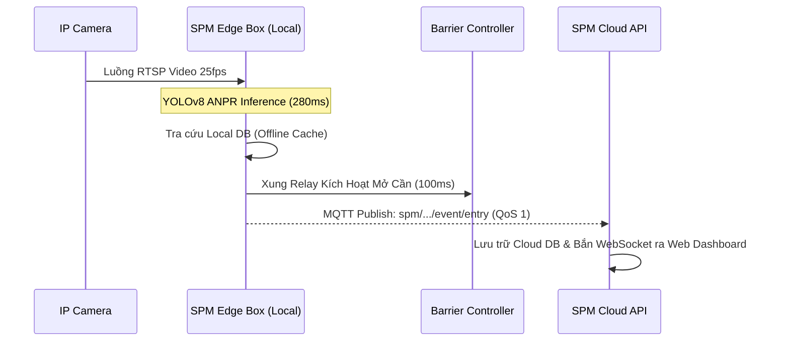

# SPM – MASTER API SPECIFICATION
**Hệ sinh thái Smart Parking Management (Enterprise Hybrid Cloud + Edge AI)**
*Document Version: 1.0.0 | Date: 2026-11-19 | Protocols: REST (OpenAPI 3.0), WebSocket (Realtime), MQTT (IoT Edge)*

---

## 1. NGUYÊN TẮC THIẾT KẾ & QUY CHUẨN GIAO TIẾP (API STANDARDS)

### 1.1. Chuẩn hóa Định dạng JSON Response
Mọi API Endpoint trong hệ thống SPM bắt buộc tuân thủ cấu trúc dữ liệu chuẩn nhất quán:

#### Trường hợp Thành công (HTTP 200, 201)
```json
{
  "status": "success",
  "message": "Chi tiết kết quả thực hiện thành công",
  "data": { ... },
  "meta": {
    "page": 1,
    "limit": 20,
    "total_records": 1450,
    "total_pages": 73
  }
}
```

#### Trường hợp Thất bại / Lỗi (HTTP 400, 401, 403, 404, 409, 422, 500)
```json
{
  "status": "error",
  "message": "Thông điệp lỗi thân thiện với người dùng",
  "error": {
    "code": "ERR_BARRIER_CONTROLLER_TIMEOUT",
    "details": [
      {
        "field": "lane_id",
        "issue": "Bộ điều khiển barrier tại làn L01_OUT không phản hồi trong 1000ms"
      }
    ],
    "timestamp": "2026-11-19T14:26:00Z",
    "trace_id": "req-98fbc1-82ab-41c2"
  }
}
```

### 1.2. Headers Bắt buộc
- `Authorization: Bearer <jwt_access_token>`: Xác thực danh tính người dùng hoặc Edge Node.
- `X-Tenant-Id: <uuid>`: Bắt buộc đối với các yêu cầu từ Tenant Admin và Staff để đảm bảo cách ly dữ liệu.
- `X-Idempotency-Key: <uuid>`: Bắt buộc cho các giao dịch tài chính, tạo phiên đỗ xe và lệnh đóng mở barrier để chống trùng lặp dữ liệu do gửi lại gói tin (Replay Attack / Network Retry).

---

## 2. BỘ ĐẶC TẢ REST API ENDPOINTS CHÍNH (/api/v1)

### 2.1. Authentication & IAM (`/api/v1/auth`)

| Method | Endpoint | Mô tả & Quyền hạn | Request Payload / Params |
|---|---|---|---|
| `POST` | `/auth/login` | Đăng nhập tài khoản (Web/Mobile) | `{ email / phone, password, device_fingerprint }` |
| `POST` | `/auth/refresh` | Làm mới Access Token | `{ refresh_token }` |
| `POST` | `/auth/mfa/verify` | Xác thực mã 2FA TOTP | `{ temp_token, totp_code: "123456" }` |
| `POST` | `/auth/logout` | Đăng xuất & Thu hồi Token | `{ refresh_token }` |
| `GET` | `/auth/me` | Lấy hồ sơ tài khoản và cây quyền | Headers: `Bearer Token` |

---

### 2.2. Parking Sites & Sơ đồ Digital Twin (`/api/v1/parking-sites`)

| Method | Endpoint | Mô tả & Quyền hạn | Chức năng chính |
|---|---|---|---|
| `GET` | `/parking-sites` | Danh sách bãi đỗ xe thuộc Tenant | Lọc theo vùng, trạng thái, phân trang |
| `POST` | `/parking-sites` | Tạo mới bãi đỗ xe | Khai báo tên, tọa độ GPS, sức chứa, giờ hoạt động |
| `GET` | `/parking-sites/:id/layout` | Lấy sơ đồ số Digital Twin bãi xe | Trả về cấu trúc cây Tầng -> Khu vực -> Ô đỗ và trạng thái thời gian thực |
| `GET` | `/parking-sites/:id/occupancy` | Thống kê tỷ lệ lấp đầy trực tiếp | Số xe ô tô/xe máy đang đỗ, số chỗ trống từng tầng |

---

### 2.3. Quản lý Làn & Điều khiển Barrier (`/api/v1/parking-lanes`)

| Method | Endpoint | Mô tả & Quyền hạn | Request Payload / Cơ chế Bảo vệ |
|---|---|---|---|
| `GET` | `/parking-lanes` | Danh sách các làn xe tại bãi | Query: `site_id`, `lane_type` |
| `POST` | `/parking-lanes/:id/barrier/open` | Mở Barrier Cưỡng bức (Staff) | `{ "reason": "Xe ưu tiên cứu hỏa", "operator_note": "Còi hụ khẩn cấp" }` *(Ghi nhận Audit Log bất biến)* |
| `POST` | `/parking-lanes/:id/barrier/close` | Hạ Barrier | Cần xác nhận không có vật cản trên vòng từ an toàn (Loop 2) |
| `GET` | `/parking-lanes/:id/status` | Lấy trạng thái phần cứng làn | Tình trạng Camera, Barrier Gate, Màn hình LED, Cảm biến từ |

---

### 2.4. Quản lý Phiên Gửi xe (Core Parking Sessions) (`/api/v1/parking-sessions`)

#### Tạo Phiên Vào (Vehicle Entry Creation)
- **Endpoint:** `POST /api/v1/parking-sessions/entry`
- **Quyền hạn:** `parking.session.create` (Thường được gọi tự động từ Edge Node AI Agent)
- **Request Body (Zod Schema Validation):**
```json
{
  "site_id": "018e5f2a-79b1-7a2e-839e-21ad87293b11",
  "lane_id": "018e5f2a-79b1-7a2e-839e-21ad87293b22",
  "clean_plate": "51H98765",
  "display_plate": "51H-987.65",
  "confidence_score": 98.4,
  "vehicle_type": "CAR_SEDAN",
  "entry_time": "2026-11-19T14:30:00Z",
  "entry_image_url": "https://storage.spm.io/tenants/vin/sites/lm81/2026/11/19/entry_full_51H98765.jpg",
  "entry_plate_crop_url": "https://storage.spm.io/tenants/vin/sites/lm81/2026/11/19/entry_plate_51H98765.jpg",
  "ai_model_version": "YOLOv8-ANPR-VN-v2.4",
  "is_offline_event": false
}
```

- **Response Payload (JSON):**
```json
{
  "status": "success",
  "message": "Phiên gửi xe đã được khởi tạo thành công",
  "data": {
    "session_id": "018e5f2a-89aa-7bc4-912f-981122334455",
    "plate_number": "51H-987.65",
    "subscription_type": "MONTHLY_RESIDENT",
    "is_authorized": true,
    "action_required": "AUTO_OPEN_BARRIER",
    "entry_time": "2026-11-19T14:30:00Z"
  }
}
```

#### Xử lý Xe Ra & Tính Cước (Vehicle Exit & Fee Calculation)
- **Endpoint:** `POST /api/v1/parking-sessions/exit-check`
- **Request Body:**
```json
{
  "site_id": "018e5f2a-79b1-7a2e-839e-21ad87293b11",
  "lane_id": "018e5f2a-79b1-7a2e-839e-21ad87293b33",
  "clean_plate": "51H98765",
  "exit_time": "2026-11-19T18:15:00Z",
  "exit_image_url": "https://storage.spm.io/tenants/vin/sites/lm81/2026/11/19/exit_full_51H98765.jpg"
}
```
- **Response Payload (JSON):**
```json
{
  "status": "success",
  "message": "Đã khớp phiên gửi xe thành công",
  "data": {
    "session_id": "018e5f2a-89aa-7bc4-912f-981122334455",
    "matched_entry_time": "2026-11-19T14:30:00Z",
    "duration_minutes": 225,
    "duration_text": "3 giờ 45 phút",
    "tariff_applied": "Tòa nhà Landmark 81 - Biểu phí Ngày Thường Ô tô",
    "total_fee": 50000.0,
    "payment_status": "UNPAID",
    "vietqr_payload": "00020101021238540010A000000727012400069704220114...",
    "vietqr_image_url": "https://api.spm.io/qr/gen/018e5f2a-89aa.png",
    "entry_image_url": "https://storage.spm.io/tenants/vin/sites/lm81/2026/11/19/entry_full_51H98765.jpg"
  }
}
```

---

### 2.5. Thanh toán & Đối soát Ngân hàng (`/api/v1/payments`)

| Method | Endpoint | Mô tả & Quyền hạn | Chức năng chính |
|---|---|---|---|
| `POST` | `/payments/cash-confirm` | Nhân viên bốt xác nhận thu tiền mặt | Phím tắt `F4`, gửi lệnh mở barrier ra |
| `POST` | `/payments/vietqr/webhook` | Webhook ngân hàng thụ hưởng (Napas) | Bắt buộc đối soát chữ ký điện tử HMAC-SHA256, chuyển trạng thái `PAID` |
| `POST` | `/payments/refund` | Yêu cầu hoàn tiền giao dịch lỗi | Quy trình phê duyệt hoàn tiền 2 cấp |

---

### 2.6. Quản lý Sinh trắc học & Consent (`/api/v1/biometrics`)
*Tuân thủ Luật Bảo vệ dữ liệu cá nhân VN số 91/2025/QH15:*

- **`POST /api/v1/biometrics/consent`**: Ghi nhận hành động ký chấp thuận xử lý khuôn mặt (Lưu địa chỉ IP, User Agent, Mã băm điều khoản).
- **`POST /api/v1/biometrics/enroll`**: Đăng ký mẫu khuôn mặt (Mã hóa một chiều vector 512 dimensions, kiểm tra 3D liveness).
- **`DELETE /api/v1/biometrics/revoke`**: **Quyền được rút lại đồng ý:** Ngay lập tức xóa vector embedding khỏi Cloud DB và tất cả bộ nhớ cache của Edge Node tại bãi xe.

---

## 3. GIAO THỨC WEBSOCKET REALTIME EVENTS (WSS PROTOCOL)

- **URL:** `wss://api.spm.io/ws/v1/realtime`
- **Cơ chế Xác thực:** Gửi Access Token qua Sec-WebSocket-Protocol hoặc tin nhắn đầu tiên `{ "type": "AUTH", "token": "..." }`.

### 3.1. Đăng ký Kênh (Topic Subscriptions)
```json
{
  "action": "SUBSCRIBE",
  "channels": [
    "tenant:{tenant_id}:site:{site_id}:lane:L01_IN",
    "tenant:{tenant_id}:site:{site_id}:lane:L01_OUT",
    "alerts:site:{site_id}"
  ]
}
```

### 3.2. Sự kiện Phát hiện Xe & Kết quả ANPR (`anpr.recognized`)
Server bắn về Web Staff Cabin khi AI nhận diện xong:
```json
{
  "event": "anpr.recognized",
  "timestamp": 1795098600000,
  "data": {
    "lane_id": "018e5f2a-79b1-7a2e-839e-21ad87293b22",
    "plate_number": "51H-987.65",
    "clean_plate": "51H98765",
    "confidence": 98.6,
    "vehicle_type": "CAR_SEDAN",
    "crop_image_url": "https://storage.spm.io/.../crop.jpg",
    "status": "VALID_TICKET",
    "auto_barrier_trigger": true
  }
}
```

### 3.3. Sự kiện Thanh toán Thành công Realtime (`payment.succeeded`)
```json
{
  "event": "payment.succeeded",
  "session_id": "018e5f2a-89aa-7bc4-912f-981122334455",
  "amount": 50000,
  "method": "VIETQR",
  "transaction_id": "MB_20261119_998124",
  "gate_command": "TRIGGER_OPEN_BARRIER"
}
```

---

## 4. KIẾN TRÚC GIAO TIẾP IOT & MQTT PROTOCOL (EDGE TO CLOUD)



### 4.1. Không gian Chủ đề MQTT (Topic Hierarchy)
- **Trạng thái Thiết bị (Heartbeat):**
  `spm/{tenant_id}/{site_id}/device/{device_id}/telemetry`
- **Sự kiện Nhận diện tại Làn:**
  `spm/{tenant_id}/{site_id}/lane/{lane_id}/event/detected`
- **Lệnh Điều khiển Barrier từ Cloud/Staff:**
  `spm/{tenant_id}/{site_id}/lane/{lane_id}/command/barrier`

---

## 5. GIAO THỨC ĐỒNG BỘ HYBRID OFFLINE-SYNC (EDGE RESILIENCE)

### 5.1. Nguyên tắc Xử lý khi Đứt Cáp Internet
1. **Edge Local First:** Bộ Edge Agent lưu trữ danh bạ toàn bộ xe vé tháng và biểu giá tính cước trên SQLite/PostgreSQL nội bộ tại trạm bãi xe. Xe ra vào và thu tiền mặt vẫn diễn ra hoàn toàn bình thường khi mất Internet.
2. **Hàng đợi Đồng bộ Cục bộ (Sync Outbox Queue):** Mọi sự kiện vào/ra trong thời gian mất mạng được lưu vào bảng `sync_events` tại Edge với cờ `is_offline_created: true`.
3. **Chiến lược Giải quyết Xung đột (Conflict Resolution):**
   - Sự kiện đỗ xe: Áp dụng quy tắc bổ sung (Append-Only Events), Cloud tiếp nhận và sắp xếp theo `timestamp` chuẩn phát sinh tại Edge.
   - Giao dịch thanh toán trực tuyến: Chỉ Cloud mới có quyền quyết định cuối cùng về việc xác thực giao dịch chuyển khoản ngân hàng.
