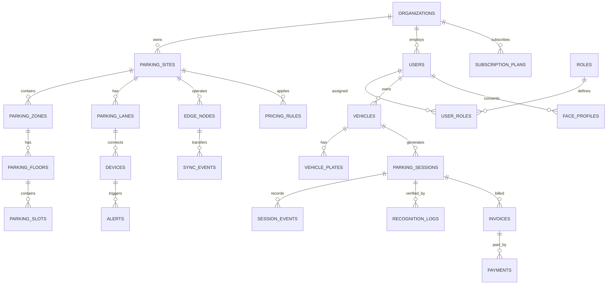

# SPM – MASTER DATABASE SPECIFICATION
**Hệ sinh thái Smart Parking Management (Enterprise Hybrid Cloud + Edge AI)**
*Database Engine: PostgreSQL 16+ with PostGIS & pg_trgm Extensions | Document Version: 1.0.0 | Date: 2026-11-19*

---

## 1. NGUYÊN TẮC THIẾT KẾ & QUY CHUẨN DỮ LIỆU (DATABASE PRINCIPLES)

### 1.1. Chuẩn hóa & Quy tắc đặt tên (Naming Conventions)
- **Tên bảng & Tên cột:** Toàn bộ sử dụng chữ thường, phân cách bằng dấu gạch dưới (`snake_case`), danh từ số nhiều cho tên bảng (`organizations`, `parking_sessions`).
- **Khóa chính (Primary Key):** Luôn sử dụng kiểu dữ liệu `UUID v7` (được tối ưu hóa theo thời gian sắp xếp tăng dần, tránh phân mảnh B-Tree index tốt hơn UUID v4). Tên cột luôn là `id`.
- **Khóa ngoại (Foreign Key):** `<singular_table_name>_id` (ví dụ: `tenant_id`, `site_id`, `vehicle_id`, `lane_id`).
- **Audit Columns bắt buộc cho mọi bảng:**
  - `created_at TIMESTAMPTZ NOT NULL DEFAULT CURRENT_TIMESTAMP`
  - `updated_at TIMESTAMPTZ NOT NULL DEFAULT CURRENT_TIMESTAMP`
  - `deleted_at TIMESTAMPTZ NULL` (Hỗ trợ Soft Delete cho các thực thể cốt lõi)
- **Chuẩn hóa Biển số xe (Normalized Plate):** Mọi bảng lưu trữ biển số xe bắt buộc có 2 trường:
  - `display_plate VARCHAR(32)`: Định dạng hiển thị có dấu chấm, gạch ngang (VD: `51H-987.65`).
  - `clean_plate VARCHAR(32)`: Chuỗi ký tự in hoa, đã loại bỏ toàn bộ khoảng trắng, dấu chấm, dấu gạch nối (VD: `51H98765`), phục vụ index và so khớp chính xác tuyệt đối.

### 1.2. Chiến lược Đa người thuê (Multi-Tenancy Isolation)
Hệ thống sử dụng mô hình **Shared Database, Pooled Schema với Row-Level Security (RLS)**:
- Tất cả bảng thuộc phạm vi nghiệp vụ doanh nghiệp đều có trường `tenant_id UUID NOT NULL REFERENCES organizations(id) ON DELETE CASCADE`.
- Kích hoạt PostgreSQL RLS:
```sql
ALTER TABLE parking_sessions ENABLE ROW LEVEL SECURITY;
CREATE POLICY tenant_isolation_policy ON parking_sessions
    AS RESTRICTIVE
    USING (tenant_id = NULLIF(current_setting('app.current_tenant_id', true), '')::UUID);
```

---

## 2. SƠ ĐỒ THỰC THỂ QUAN HỆ CỐT LÕI (CORE DOMAIN ERD)



---

## 3. CHI TIẾT 12 NHÓM BẢNG POSTGRESQL (TABLE SCHEMAS)

### NHÓM 1: IDENTITY & ACCESS MANAGEMENT (IAM)

```sql
-- 1.1. Bảng Người dùng
CREATE TABLE users (
    id UUID PRIMARY KEY DEFAULT gen_random_uuid(),
    tenant_id UUID REFERENCES organizations(id) ON DELETE CASCADE,
    email VARCHAR(255) UNIQUE,
    phone_number VARCHAR(20) UNIQUE,
    password_hash VARCHAR(255) NOT NULL,
    full_name VARCHAR(150) NOT NULL,
    avatar_url VARCHAR(500),
    user_type VARCHAR(30) NOT NULL DEFAULT 'CUSTOMER', -- SUPER_ADMIN, ORG_ADMIN, MANAGER, STAFF, CASHIER, CUSTOMER
    is_active BOOLEAN NOT NULL DEFAULT TRUE,
    is_mfa_enabled BOOLEAN NOT NULL DEFAULT FALSE,
    mfa_secret VARCHAR(100),
    last_login_at TIMESTAMPTZ,
    last_login_ip INET,
    created_at TIMESTAMPTZ NOT NULL DEFAULT CURRENT_TIMESTAMP,
    updated_at TIMESTAMPTZ NOT NULL DEFAULT CURRENT_TIMESTAMP,
    deleted_at TIMESTAMPTZ
);

-- 1.2. Bảng Vai trò (Roles)
CREATE TABLE roles (
    id UUID PRIMARY KEY DEFAULT gen_random_uuid(),
    tenant_id UUID REFERENCES organizations(id) ON DELETE CASCADE, -- NULL nếu là System Role
    code VARCHAR(50) NOT NULL,
    name VARCHAR(100) NOT NULL,
    description TEXT,
    is_system BOOLEAN NOT NULL DEFAULT FALSE,
    created_at TIMESTAMPTZ NOT NULL DEFAULT CURRENT_TIMESTAMP,
    updated_at TIMESTAMPTZ NOT NULL DEFAULT CURRENT_TIMESTAMP
);

-- 1.3. Bảng Quyền hạn (Permissions)
CREATE TABLE permissions (
    id UUID PRIMARY KEY DEFAULT gen_random_uuid(),
    module VARCHAR(50) NOT NULL, -- CORE_DASH, PARK_LANE, BILLING, AI_ANPR...
    action VARCHAR(50) NOT NULL, -- read, create, update, delete, execute, override
    code VARCHAR(100) NOT NULL UNIQUE, -- parking.session.override, parking.barrier.open
    description TEXT
);

-- 1.4. Bảng Gán Quyền cho Vai trò (Role Permissions)
CREATE TABLE role_permissions (
    role_id UUID NOT NULL REFERENCES roles(id) ON DELETE CASCADE,
    permission_id UUID NOT NULL REFERENCES permissions(id) ON DELETE CASCADE,
    PRIMARY KEY (role_id, permission_id)
);

-- 1.5. Bảng Phân vai trò cho Người dùng (User Roles with Site Scope)
CREATE TABLE user_roles (
    user_id UUID NOT NULL REFERENCES users(id) ON DELETE CASCADE,
    role_id UUID NOT NULL REFERENCES roles(id) ON DELETE CASCADE,
    site_id UUID REFERENCES parking_sites(id) ON DELETE CASCADE, -- Giới hạn quyền trong bãi xe cụ thể, NULL = Toàn doanh nghiệp
    PRIMARY KEY (user_id, role_id, site_id)
);
```

---

### NHÓM 2: TENANT & ENTERPRISE MANAGEMENT

```sql
-- 2.1. Bảng Doanh nghiệp (Organizations / Tenants)
CREATE TABLE organizations (
    id UUID PRIMARY KEY DEFAULT gen_random_uuid(),
    code VARCHAR(50) NOT NULL UNIQUE, -- Mã định danh DN: VINCOM, SUNGROUP, PHU_MY_HUNG
    name VARCHAR(255) NOT NULL,
    tax_code VARCHAR(50),
    contact_email VARCHAR(255) NOT NULL,
    contact_phone VARCHAR(20) NOT NULL,
    address TEXT,
    subscription_status VARCHAR(30) NOT NULL DEFAULT 'ACTIVE', -- TRIAL, ACTIVE, SUSPENDED, TERMINATED
    max_sites INT NOT NULL DEFAULT 1,
    max_lanes INT NOT NULL DEFAULT 4,
    max_cameras INT NOT NULL DEFAULT 8,
    settings JSONB NOT NULL DEFAULT '{}'::jsonb, -- Branding, logo, timezone, currency
    created_at TIMESTAMPTZ NOT NULL DEFAULT CURRENT_TIMESTAMP,
    updated_at TIMESTAMPTZ NOT NULL DEFAULT CURRENT_TIMESTAMP,
    deleted_at TIMESTAMPTZ
);

-- 2.2. Bảng Hợp đồng Thuê bao SaaS (Tenant Subscriptions)
CREATE TABLE tenant_subscriptions (
    id UUID PRIMARY KEY DEFAULT gen_random_uuid(),
    tenant_id UUID NOT NULL REFERENCES organizations(id) ON DELETE CASCADE,
    plan_tier VARCHAR(50) NOT NULL, -- STARTER, PRO, ENTERPRISE
    billing_cycle VARCHAR(20) NOT NULL, -- MONTHLY, ANNUAL
    start_date DATE NOT NULL,
    end_date DATE NOT NULL,
    price_amount NUMERIC(15,2) NOT NULL,
    currency VARCHAR(10) NOT NULL DEFAULT 'VND',
    auto_renew BOOLEAN NOT NULL DEFAULT TRUE,
    payment_status VARCHAR(30) NOT NULL DEFAULT 'PAID',
    created_at TIMESTAMPTZ NOT NULL DEFAULT CURRENT_TIMESTAMP,
    updated_at TIMESTAMPTZ NOT NULL DEFAULT CURRENT_TIMESTAMP
);
```

---

### NHÓM 3: PARKING SITE & SPATIAL DIGITAL TWIN

```sql
-- 3.1. Bảng Cơ sở Bãi xe
CREATE TABLE parking_sites (
    id UUID PRIMARY KEY DEFAULT gen_random_uuid(),
    tenant_id UUID NOT NULL REFERENCES organizations(id) ON DELETE CASCADE,
    code VARCHAR(50) NOT NULL, -- PK-LANDMARK81
    name VARCHAR(255) NOT NULL,
    site_type VARCHAR(50) NOT NULL, -- MALL, RESIDENTIAL, OFFICE, HOSPITAL, AIRPORT
    address TEXT NOT NULL,
    latitude DOUBLE PRECISION,
    longitude DOUBLE PRECISION,
    total_capacity INT NOT NULL DEFAULT 0,
    car_capacity INT NOT NULL DEFAULT 0,
    motorcycle_capacity INT NOT NULL DEFAULT 0,
    operating_hours JSONB NOT NULL DEFAULT '{"open": "00:00", "close": "23:59", "is_24_7": true}'::jsonb,
    is_active BOOLEAN NOT NULL DEFAULT TRUE,
    created_at TIMESTAMPTZ NOT NULL DEFAULT CURRENT_TIMESTAMP,
    updated_at TIMESTAMPTZ NOT NULL DEFAULT CURRENT_TIMESTAMP,
    deleted_at TIMESTAMPTZ,
    UNIQUE(tenant_id, code)
);

-- 3.2. Bảng Tầng đỗ xe (Floors)
CREATE TABLE parking_floors (
    id UUID PRIMARY KEY DEFAULT gen_random_uuid(),
    site_id UUID NOT NULL REFERENCES parking_sites(id) ON DELETE CASCADE,
    floor_code VARCHAR(30) NOT NULL, -- B1, B2, B3, 1F, 2F
    floor_name VARCHAR(100) NOT NULL,
    level_order INT NOT NULL DEFAULT 0,
    max_height_meters NUMERIC(3,2), -- 2.2m
    blueprint_map_url VARCHAR(500), -- SVG/JSON layout file
    created_at TIMESTAMPTZ NOT NULL DEFAULT CURRENT_TIMESTAMP,
    updated_at TIMESTAMPTZ NOT NULL DEFAULT CURRENT_TIMESTAMP,
    UNIQUE(site_id, floor_code)
);

-- 3.3. Bảng Khu vực (Zones)
CREATE TABLE parking_zones (
    id UUID PRIMARY KEY DEFAULT gen_random_uuid(),
    floor_id UUID NOT NULL REFERENCES parking_floors(id) ON DELETE CASCADE,
    zone_code VARCHAR(30) NOT NULL, -- ZONE_A, ZONE_B, VIP_ZONE, EV_CHARGING
    zone_name VARCHAR(100) NOT NULL,
    allowed_vehicle_type VARCHAR(30) NOT NULL, -- CAR, MOTORBIKE, TRUCK, EV_CAR
    capacity INT NOT NULL DEFAULT 0,
    created_at TIMESTAMPTZ NOT NULL DEFAULT CURRENT_TIMESTAMP,
    updated_at TIMESTAMPTZ NOT NULL DEFAULT CURRENT_TIMESTAMP,
    UNIQUE(floor_id, zone_code)
);

-- 3.4. Bảng Vị trí ô đỗ cụ thể (Slots)
CREATE TABLE parking_slots (
    id UUID PRIMARY KEY DEFAULT gen_random_uuid(),
    zone_id UUID NOT NULL REFERENCES parking_zones(id) ON DELETE CASCADE,
    slot_number VARCHAR(30) NOT NULL, -- B1-A12
    slot_type VARCHAR(30) NOT NULL DEFAULT 'STANDARD', -- STANDARD, VIP, HANDICAPPED, EV_CHARGING
    occupancy_status VARCHAR(30) NOT NULL DEFAULT 'EMPTY', -- EMPTY, OCCUPIED, RESERVED, MAINTENANCE
    sensor_device_id UUID, -- Liên kết cảm biến siêu âm
    current_vehicle_id UUID,
    last_status_changed_at TIMESTAMPTZ NOT NULL DEFAULT CURRENT_TIMESTAMP,
    coordinates JSONB, -- {"x": 120, "y": 340, "polygon": [[...]]}
    created_at TIMESTAMPTZ NOT NULL DEFAULT CURRENT_TIMESTAMP,
    updated_at TIMESTAMPTZ NOT NULL DEFAULT CURRENT_TIMESTAMP,
    UNIQUE(zone_id, slot_number)
);
```

---

### NHÓM 4: LANE MANAGEMENT & HARDWARE TOPOLOGY

```sql
-- 4.1. Bảng Làn xe
CREATE TABLE parking_lanes (
    id UUID PRIMARY KEY DEFAULT gen_random_uuid(),
    site_id UUID NOT NULL REFERENCES parking_sites(id) ON DELETE CASCADE,
    edge_node_id UUID, -- Liên kết Edge Box điều khiển trực tiếp làn này
    lane_code VARCHAR(30) NOT NULL, -- L01_IN, L02_OUT, L03_BIDI
    lane_name VARCHAR(100) NOT NULL,
    lane_type VARCHAR(30) NOT NULL, -- ENTRY, EXIT, BIDIRECTIONAL
    operating_mode VARCHAR(30) NOT NULL DEFAULT 'AUTO_AI', -- AUTO_AI, MANUAL_STAFF, EMERGENCY_OPEN, CLOSED
    is_active BOOLEAN NOT NULL DEFAULT TRUE,
    created_at TIMESTAMPTZ NOT NULL DEFAULT CURRENT_TIMESTAMP,
    updated_at TIMESTAMPTZ NOT NULL DEFAULT CURRENT_TIMESTAMP,
    UNIQUE(site_id, lane_code)
);

-- 4.2. Bảng Cấu hình & Gán Thiết bị cho Làn (Lane Devices Mapping)
CREATE TABLE lane_devices (
    id UUID PRIMARY KEY DEFAULT gen_random_uuid(),
    lane_id UUID NOT NULL REFERENCES parking_lanes(id) ON DELETE CASCADE,
    device_id UUID NOT NULL REFERENCES devices(id) ON DELETE CASCADE,
    device_role VARCHAR(50) NOT NULL, -- CAMERA_ANPR_FRONT, CAMERA_ANPR_BACK, CAMERA_OVERVIEW, BARRIER_GATE, LOOP_DETECTOR_ENTRY, LOOP_DETECTOR_EXIT, LED_DISPLAY, QR_READER
    settings JSONB NOT NULL DEFAULT '{}'::jsonb,
    created_at TIMESTAMPTZ NOT NULL DEFAULT CURRENT_TIMESTAMP,
    UNIQUE(lane_id, device_role)
);
```

---

### NHÓM 5: VEHICLE & REGISTRATION

```sql
-- 5.1. Bảng Phương tiện
CREATE TABLE vehicles (
    id UUID PRIMARY KEY DEFAULT gen_random_uuid(),
    tenant_id UUID NOT NULL REFERENCES organizations(id) ON DELETE CASCADE,
    owner_user_id UUID REFERENCES users(id) ON DELETE SET NULL,
    clean_plate VARCHAR(32) NOT NULL,
    display_plate VARCHAR(32) NOT NULL,
    vehicle_type VARCHAR(30) NOT NULL, -- MOTORCYCLE, CAR_SEDAN, CAR_SUV, TRUCK, EV_CAR, BICYCLE
    brand VARCHAR(50), -- Toyota, Honda, VinFast
    model VARCHAR(50), -- VF8, Camry, SH150i
    color VARCHAR(30),
    registration_card_url VARCHAR(500),
    vehicle_status VARCHAR(30) NOT NULL DEFAULT 'ACTIVE', -- ACTIVE, BLOCKED, STOLEN_ALERT
    created_at TIMESTAMPTZ NOT NULL DEFAULT CURRENT_TIMESTAMP,
    updated_at TIMESTAMPTZ NOT NULL DEFAULT CURRENT_TIMESTAMP,
    deleted_at TIMESTAMPTZ,
    UNIQUE(tenant_id, clean_plate)
);

-- 5.2. Bảng Danh sách Đen & Xe cần theo dõi đặc biệt (Vehicle Blacklist)
CREATE TABLE vehicle_blacklists (
    id UUID PRIMARY KEY DEFAULT gen_random_uuid(),
    tenant_id UUID NOT NULL REFERENCES organizations(id) ON DELETE CASCADE,
    clean_plate VARCHAR(32) NOT NULL,
    reason TEXT NOT NULL, -- Trộm cắp, Chưa đóng phạt, Gây rối bãi xe
    reported_by UUID REFERENCES users(id),
    is_active BOOLEAN NOT NULL DEFAULT TRUE,
    created_at TIMESTAMPTZ NOT NULL DEFAULT CURRENT_TIMESTAMP
);
```

---

### NHÓM 6: AI ANPR & INFERENCE LOGS

```sql
-- 6.1. Bảng Nhật ký Nhận diện Biển số (Inference Logs)
CREATE TABLE recognition_logs (
    id UUID PRIMARY KEY DEFAULT gen_random_uuid(),
    tenant_id UUID NOT NULL REFERENCES organizations(id) ON DELETE CASCADE,
    site_id UUID NOT NULL REFERENCES parking_sites(id) ON DELETE CASCADE,
    lane_id UUID NOT NULL REFERENCES parking_lanes(id) ON DELETE CASCADE,
    session_id UUID, -- Liên kết sau khi session được tạo/khớp
    device_id UUID NOT NULL,
    direction VARCHAR(10) NOT NULL, -- IN, OUT
    recognized_clean_plate VARCHAR(32),
    recognized_display_plate VARCHAR(32),
    confidence_score NUMERIC(5,2) NOT NULL, -- 0.00 -> 100.00
    detected_vehicle_type VARCHAR(30),
    plate_bounding_box JSONB, -- {"x": 120, "y": 80, "w": 200, "h": 70}
    raw_image_url VARCHAR(500) NOT NULL,
    cropped_plate_url VARCHAR(500) NOT NULL,
    inference_time_ms INT NOT NULL, -- Thời gian xử lý model (ms)
    ai_model_version VARCHAR(50) NOT NULL,
    is_manually_corrected BOOLEAN NOT NULL DEFAULT FALSE,
    corrected_plate VARCHAR(32),
    corrected_by UUID REFERENCES users(id),
    created_at TIMESTAMPTZ NOT NULL DEFAULT CURRENT_TIMESTAMP
);

-- 6.2. Bảng Đăng ký Phiên bản Mô hình AI
CREATE TABLE ai_models (
    id UUID PRIMARY KEY DEFAULT gen_random_uuid(),
    model_name VARCHAR(100) NOT NULL, -- SPM-ANPR-VN-YOLOv8
    version_tag VARCHAR(50) NOT NULL, -- v2.4.1
    model_type VARCHAR(50) NOT NULL, -- DETECTION_ANPR, OCR_PLATE, FACE_RECOGNITION
    weights_s3_url VARCHAR(500) NOT NULL,
    checksum_sha256 VARCHAR(64) NOT NULL,
    target_hardware VARCHAR(50) NOT NULL, -- JETSON_ORIN, X86_TENSORRT, INTEL_OPENVINO
    accuracy_metric NUMERIC(5,2),
    is_active BOOLEAN NOT NULL DEFAULT FALSE,
    created_at TIMESTAMPTZ NOT NULL DEFAULT CURRENT_TIMESTAMP
);
```

---

### NHÓM 7: BIOMETRIC FACE & CONSENT GOVERNANCE (TUÂN THỦ LUẬT 91/2025/QH15)

```sql
-- 7.1. Bảng Hồ sơ Khuôn mặt Sinh trắc học
CREATE TABLE face_profiles (
    id UUID PRIMARY KEY DEFAULT gen_random_uuid(),
    user_id UUID NOT NULL UNIQUE REFERENCES users(id) ON DELETE CASCADE,
    face_embedding BYTEA NOT NULL, -- 512-dimensional vector mã hóa một chiều (AES-GCM-256)
    embedding_model VARCHAR(50) NOT NULL DEFAULT 'ArcFace-ResNet50',
    sample_quality_score NUMERIC(4,2) NOT NULL,
    liveness_verified BOOLEAN NOT NULL DEFAULT TRUE,
    created_at TIMESTAMPTZ NOT NULL DEFAULT CURRENT_TIMESTAMP,
    updated_at TIMESTAMPTZ NOT NULL DEFAULT CURRENT_TIMESTAMP
);

-- 7.2. Bảng Nhật ký Đồng ý Xử lý Dữ liệu Cá nhân (Consent Logs)
CREATE TABLE biometric_consent_logs (
    id UUID PRIMARY KEY DEFAULT gen_random_uuid(),
    user_id UUID NOT NULL REFERENCES users(id) ON DELETE CASCADE,
    consent_version VARCHAR(20) NOT NULL, -- v1.0, v2.0
    action VARCHAR(30) NOT NULL, -- CONSENT_GRANTED, CONSENT_REVOKED
    signed_ip INET NOT NULL,
    user_agent TEXT,
    revoked_reason TEXT,
    action_at TIMESTAMPTZ NOT NULL DEFAULT CURRENT_TIMESTAMP
);
```

---

### NHÓM 8: PARKING SESSIONS & MOVEMENTS (TRUNG TÂM NGHIỆP VỤ)

```sql
-- 8.1. Bảng Phiên Gửi xe (Core Parking Sessions)
CREATE TABLE parking_sessions (
    id UUID PRIMARY KEY DEFAULT gen_random_uuid(),
    tenant_id UUID NOT NULL REFERENCES organizations(id) ON DELETE CASCADE,
    site_id UUID NOT NULL REFERENCES parking_sites(id) ON DELETE CASCADE,
    vehicle_id UUID REFERENCES vehicles(id) ON DELETE SET NULL,
    subscription_id UUID, -- Nếu là xe vé tháng
    clean_plate_entry VARCHAR(32) NOT NULL,
    display_plate_entry VARCHAR(32) NOT NULL,
    entry_time TIMESTAMPTZ NOT NULL,
    entry_lane_id UUID NOT NULL REFERENCES parking_lanes(id),
    entry_image_url VARCHAR(500) NOT NULL,
    entry_plate_crop_url VARCHAR(500) NOT NULL,
    entry_recognition_id UUID REFERENCES recognition_logs(id),
    
    clean_plate_exit VARCHAR(32),
    display_plate_exit VARCHAR(32),
    exit_time TIMESTAMPTZ,
    exit_lane_id UUID REFERENCES parking_lanes(id),
    exit_image_url VARCHAR(500),
    exit_plate_crop_url VARCHAR(500),
    exit_recognition_id UUID REFERENCES recognition_logs(id),
    
    duration_minutes INT GENERATED ALWAYS AS (
        CASE WHEN exit_time IS NOT NULL 
        THEN ROUND(EXTRACT(EPOCH FROM (exit_time - entry_time)) / 60)
        ELSE NULL END
    ) STORED,
    
    status VARCHAR(30) NOT NULL DEFAULT 'ACTIVE', -- ACTIVE, PENDING_PAYMENT, COMPLETED, REVIEW_REQUIRED, ABNORMAL
    pricing_rule_id UUID,
    calculated_fee NUMERIC(12,2) NOT NULL DEFAULT 0,
    paid_fee NUMERIC(12,2) NOT NULL DEFAULT 0,
    payment_status VARCHAR(30) NOT NULL DEFAULT 'UNPAID', -- UNPAID, PARTIAL, PAID, WAIVED, REFUNDED
    
    is_offline_created BOOLEAN NOT NULL DEFAULT FALSE,
    edge_sync_status VARCHAR(20) NOT NULL DEFAULT 'SYNCED', -- PENDING, SYNCED, CONFLICT
    created_at TIMESTAMPTZ NOT NULL DEFAULT CURRENT_TIMESTAMP,
    updated_at TIMESTAMPTZ NOT NULL DEFAULT CURRENT_TIMESTAMP
) PARTITION BY RANGE (entry_time);

-- 8.2. Bảng Sự kiện Chi tiết trong Phiên (Movements & Overrides)
CREATE TABLE session_events (
    id UUID PRIMARY KEY DEFAULT gen_random_uuid(),
    session_id UUID NOT NULL, -- Khóa ngoại logic với parking_sessions
    event_type VARCHAR(50) NOT NULL, -- BARRIER_TRIGGERED, MANUAL_PLATE_EDIT, CASH_COLLECTED, QR_SCANNED, TAILGATING_DETECTED
    operator_user_id UUID REFERENCES users(id),
    reason TEXT,
    metadata JSONB NOT NULL DEFAULT '{}'::jsonb,
    created_at TIMESTAMPTZ NOT NULL DEFAULT CURRENT_TIMESTAMP
);
```

---

### NHÓM 9: BILLING, PRICING RULES & PAYMENTS

```sql
-- 9.1. Bảng Quy tắc Tính phí (Pricing Rules)
CREATE TABLE pricing_rules (
    id UUID PRIMARY KEY DEFAULT gen_random_uuid(),
    tenant_id UUID NOT NULL REFERENCES organizations(id) ON DELETE CASCADE,
    site_id UUID NOT NULL REFERENCES parking_sites(id) ON DELETE CASCADE,
    rule_name VARCHAR(100) NOT NULL,
    vehicle_type VARCHAR(30) NOT NULL, -- CAR, MOTORCYCLE
    tariff_model VARCHAR(30) NOT NULL, -- FLAT, HOURLY_PROGRESSIVE, TIME_BLOCK, OVERNIGHT
    grace_period_minutes INT NOT NULL DEFAULT 15, -- Thời gian ân hạn miễn phí
    rates_definition JSONB NOT NULL, -- Cấu hình chi tiết khung giờ & mức phí
    priority INT NOT NULL DEFAULT 1,
    is_active BOOLEAN NOT NULL DEFAULT TRUE,
    created_at TIMESTAMPTZ NOT NULL DEFAULT CURRENT_TIMESTAMP,
    updated_at TIMESTAMPTZ NOT NULL DEFAULT CURRENT_TIMESTAMP
);

-- 9.2. Bảng Hóa đơn & Giao dịch Thanh toán
CREATE TABLE invoices (
    id UUID PRIMARY KEY DEFAULT gen_random_uuid(),
    tenant_id UUID NOT NULL REFERENCES organizations(id) ON DELETE CASCADE,
    site_id UUID NOT NULL REFERENCES parking_sites(id) ON DELETE CASCADE,
    session_id UUID NOT NULL,
    invoice_number VARCHAR(50) NOT NULL UNIQUE,
    amount NUMERIC(12,2) NOT NULL,
    tax_amount NUMERIC(12,2) NOT NULL DEFAULT 0,
    discount_amount NUMERIC(12,2) NOT NULL DEFAULT 0,
    final_amount NUMERIC(12,2) NOT NULL,
    payment_method VARCHAR(30) NOT NULL, -- VIETQR, CASH, MOMO, ZALOPAY, CREDIT_CARD
    status VARCHAR(30) NOT NULL DEFAULT 'PENDING', -- PENDING, COMPLETED, FAILED, REFUNDED
    customer_user_id UUID REFERENCES users(id),
    einvoice_synced BOOLEAN NOT NULL DEFAULT FALSE,
    einvoice_code VARCHAR(100),
    created_at TIMESTAMPTZ NOT NULL DEFAULT CURRENT_TIMESTAMP,
    updated_at TIMESTAMPTZ NOT NULL DEFAULT CURRENT_TIMESTAMP
);

-- 9.3. Bảng Giao dịch Cổng thanh toán (Payment Gateway Transactions)
CREATE TABLE payment_transactions (
    id UUID PRIMARY KEY DEFAULT gen_random_uuid(),
    invoice_id UUID NOT NULL REFERENCES invoices(id) ON DELETE CASCADE,
    gateway_provider VARCHAR(50) NOT NULL, -- VIETQR_NAPAS, MOMO, VNPAY
    transaction_reference VARCHAR(100) NOT NULL UNIQUE, -- Mã tham chiếu từ ngân hàng
    gateway_response JSONB,
    amount NUMERIC(12,2) NOT NULL,
    currency VARCHAR(10) NOT NULL DEFAULT 'VND',
    status VARCHAR(30) NOT NULL, -- INITIATED, SUCCESS, FAILED
    verified_at TIMESTAMPTZ,
    created_at TIMESTAMPTZ NOT NULL DEFAULT CURRENT_TIMESTAMP
);
```

---

### NHÓM 10: IOT HARDWARE & DEVICE REGISTRY

```sql
-- 10.1. Bảng Thiết bị Phần cứng
CREATE TABLE devices (
    id UUID PRIMARY KEY DEFAULT gen_random_uuid(),
    tenant_id UUID NOT NULL REFERENCES organizations(id) ON DELETE CASCADE,
    site_id UUID NOT NULL REFERENCES parking_sites(id) ON DELETE CASCADE,
    device_code VARCHAR(50) NOT NULL,
    device_name VARCHAR(100) NOT NULL,
    device_type VARCHAR(50) NOT NULL, -- CAMERA_IP, BARRIER_GATE, LOOP_DETECTOR, LED_SIGN, QR_SCANNER, EDGE_BOX
    manufacturer VARCHAR(50), -- HIKVISION, DAHUA, ZKTECO, MOXA
    model_number VARCHAR(50),
    serial_number VARCHAR(100) NOT NULL UNIQUE,
    mac_address VARCHAR(20),
    ip_address INET NOT NULL,
    port INT NOT NULL DEFAULT 80,
    firmware_version VARCHAR(50),
    connection_status VARCHAR(20) NOT NULL DEFAULT 'OFFLINE', -- ONLINE, OFFLINE, DEGRADED
    last_heartbeat_at TIMESTAMPTZ,
    device_settings JSONB NOT NULL DEFAULT '{}'::jsonb,
    created_at TIMESTAMPTZ NOT NULL DEFAULT CURRENT_TIMESTAMP,
    updated_at TIMESTAMPTZ NOT NULL DEFAULT CURRENT_TIMESTAMP
);

-- 10.2. Bảng Telemetry & Sức khỏe Phần cứng
CREATE TABLE device_telemetry (
    id UUID PRIMARY KEY DEFAULT gen_random_uuid(),
    device_id UUID NOT NULL REFERENCES devices(id) ON DELETE CASCADE,
    cpu_usage_percent NUMERIC(4,1),
    memory_usage_percent NUMERIC(4,1),
    temperature_celsius NUMERIC(4,1),
    network_latency_ms INT,
    fps NUMERIC(4,1),
    recorded_at TIMESTAMPTZ NOT NULL DEFAULT CURRENT_TIMESTAMP
);
```

---

### NHÓM 11: EDGE NODES & OFFLINE SYNCHRONIZATION

```sql
-- 11.1. Bảng Edge Nodes Gateway tại Bãi xe
CREATE TABLE edge_nodes (
    id UUID PRIMARY KEY DEFAULT gen_random_uuid(),
    site_id UUID NOT NULL UNIQUE REFERENCES parking_sites(id) ON DELETE CASCADE,
    node_name VARCHAR(100) NOT NULL,
    hardware_spec VARCHAR(100), -- Jetson Orin Nano 8GB / Intel i5 IPC
    os_version VARCHAR(100), -- Ubuntu 24.04 LTS
    edge_agent_version VARCHAR(50) NOT NULL,
    sync_api_key_hash VARCHAR(255) NOT NULL,
    last_sync_at TIMESTAMPTZ,
    status VARCHAR(20) NOT NULL DEFAULT 'ACTIVE',
    created_at TIMESTAMPTZ NOT NULL DEFAULT CURRENT_TIMESTAMP,
    updated_at TIMESTAMPTZ NOT NULL DEFAULT CURRENT_TIMESTAMP
);

-- 11.2. Bảng Nhật ký Đồng bộ Dữ liệu 2 Chiều (Sync Queue)
CREATE TABLE sync_events (
    id UUID PRIMARY KEY DEFAULT gen_random_uuid(),
    edge_node_id UUID NOT NULL REFERENCES edge_nodes(id) ON DELETE CASCADE,
    entity_name VARCHAR(50) NOT NULL, -- parking_sessions, recognition_logs, invoices
    entity_id UUID NOT NULL,
    action VARCHAR(20) NOT NULL, -- INSERT, UPDATE, UPSERT
    payload JSONB NOT NULL,
    sync_direction VARCHAR(20) NOT NULL, -- EDGE_TO_CLOUD, CLOUD_TO_EDGE
    sync_status VARCHAR(20) NOT NULL DEFAULT 'PENDING', -- PENDING, COMPLETED, CONFLICT
    error_message TEXT,
    retry_count INT NOT NULL DEFAULT 0,
    created_at TIMESTAMPTZ NOT NULL DEFAULT CURRENT_TIMESTAMP,
    synced_at TIMESTAMPTZ
);
```

---

### NHÓM 12: OPERATIONS, ALERTS, AUDIT & SHIFTS

```sql
-- 12.1. Bảng Cảnh báo Sự cố (Alerts Center)
CREATE TABLE alerts (
    id UUID PRIMARY KEY DEFAULT gen_random_uuid(),
    tenant_id UUID NOT NULL REFERENCES organizations(id) ON DELETE CASCADE,
    site_id UUID NOT NULL REFERENCES parking_sites(id) ON DELETE CASCADE,
    lane_id UUID REFERENCES parking_lanes(id),
    device_id UUID REFERENCES devices(id),
    alert_type VARCHAR(50) NOT NULL, -- CAMERA_OFFLINE, BARRIER_STUCK, PLATE_MISMATCH, TAILGATING, LOW_DISK_SPACE
    severity VARCHAR(20) NOT NULL, -- INFO, WARNING, CRITICAL
    message TEXT NOT NULL,
    status VARCHAR(30) NOT NULL DEFAULT 'OPEN', -- OPEN, ACKNOWLEDGED, RESOLVED, DISMISSED
    assigned_to UUID REFERENCES users(id),
    resolved_at TIMESTAMPTZ,
    created_at TIMESTAMPTZ NOT NULL DEFAULT CURRENT_TIMESTAMP
);

-- 12.2. Bảng Bàn giao Ca trực Nhân viên (Shift Handovers)
CREATE TABLE shift_handovers (
    id UUID PRIMARY KEY DEFAULT gen_random_uuid(),
    site_id UUID NOT NULL REFERENCES parking_sites(id) ON DELETE CASCADE,
    lane_id UUID REFERENCES parking_lanes(id),
    shift_name VARCHAR(50) NOT NULL, -- CA_SANG, CA_CHIEU, CA_DEM
    outgoing_staff_id UUID NOT NULL REFERENCES users(id),
    incoming_staff_id UUID NOT NULL REFERENCES users(id),
    start_time TIMESTAMPTZ NOT NULL,
    end_time TIMESTAMPTZ NOT NULL,
    total_vehicles_processed INT NOT NULL DEFAULT 0,
    cash_collected NUMERIC(12,2) NOT NULL DEFAULT 0,
    cash_handed_over NUMERIC(12,2) NOT NULL DEFAULT 0,
    discrepancy_amount NUMERIC(12,2) NOT NULL DEFAULT 0,
    notes TEXT,
    created_at TIMESTAMPTZ NOT NULL DEFAULT CURRENT_TIMESTAMP
);

-- 12.3. Bảng Nhật ký Kiểm toán Bất biến (Immutable Audit Logs)
CREATE TABLE audit_logs (
    id UUID PRIMARY KEY DEFAULT gen_random_uuid(),
    tenant_id UUID REFERENCES organizations(id),
    user_id UUID REFERENCES users(id),
    client_ip INET NOT NULL,
    user_agent TEXT,
    action VARCHAR(100) NOT NULL, -- BARRIER_FORCE_OPEN, REVENUE_MANUAL_REFUND, TARIFF_CHANGE
    entity_name VARCHAR(50) NOT NULL,
    entity_id UUID,
    old_values JSONB,
    new_values JSONB,
    created_at TIMESTAMPTZ NOT NULL DEFAULT CURRENT_TIMESTAMP
) PARTITION BY RANGE (created_at);
```

---

## 4. CHIẾN LƯỢC ĐÁNH CHỈ MỤC & PHÂN VÙNG DỮ LIỆU (INDEXES & PARTITIONING)

### 4.1. Tối ưu hóa Tra cứu Biển số Cực tốc (Trigram Index)
Kích hoạt extension `pg_trgm` để nhân viên gõ 3-4 ký tự cuối (VD: `8765`) có thể tìm thấy biển số trong hàng triệu bản ghi dưới 10ms:
```sql
CREATE EXTENSION IF NOT EXISTS pg_trgm;

-- Index tìm kiếm biển số xe đã chuẩn hóa
CREATE INDEX idx_sessions_clean_plate_entry_trgm ON parking_sessions USING gin (clean_plate_entry gin_trgm_ops);
CREATE INDEX idx_sessions_clean_plate_exit_trgm ON parking_sessions USING gin (clean_plate_exit gin_trgm_ops);
CREATE INDEX idx_vehicles_clean_plate_trgm ON vehicles USING gin (clean_plate_plate gin_trgm_ops);
```

### 4.2. Composite Indexes cho Nghiệp vụ Thời gian thực
```sql
-- Lọc nhanh các lượt xe ĐANG TRONG BÃI tại một bãi xe cụ thể:
CREATE INDEX idx_sessions_active ON parking_sessions (site_id, status) WHERE status = 'ACTIVE';

-- Lọc giao dịch theo Tenant và Thời gian:
CREATE INDEX idx_invoices_tenant_created ON invoices (tenant_id, created_at DESC);

-- Bảng phân vùng Sessions theo tháng (Monthly Partitioning):
CREATE TABLE parking_sessions_2026_11 PARTITION OF parking_sessions
    FOR VALUES FROM ('2026-11-01 00:00:00+00') TO ('2026-12-01 00:00:00+00');
CREATE TABLE parking_sessions_2026_12 PARTITION OF parking_sessions
    FOR VALUES FROM ('2026-12-01 00:00:00+00') TO ('2027-01-01 00:00:00+00');
```
