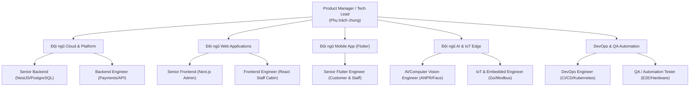

# SPM – MASTER DEVELOPMENT PLAN & ENGINEERING ROADMAP
**Hệ sinh thái Smart Parking Management (Enterprise Hybrid Cloud + Edge AI)**
*Document Version: 1.0.0 | Date: 2026-11-19 | Framework: Agile Scrum (12 Sprints / 24 Weeks to Production)*

---

## 1. PHƯƠNG PHÁP LUẬN & MÔ HÌNH VẬN HÀNH (DEVELOPMENT METHODOLOGY)

Dự án SPM Enterprise được triển khai theo mô hình **Agile Scrum kết hợp Shift-Left Security & Testing**:
- **Chu kỳ Sprint:** 2 tuần / 1 Sprint (Tổng cộng 12 Sprints = 24 tuần ~ 6 tháng để hoàn thiện phiên bản Enterprise v1.0).
- **Ceremonies:**
  - Sprint Planning (Đầu Sprint - 2h)
  - Daily Standup (Mỗi sáng 15 phút: *Hôm qua làm gì? Hôm nay làm gì? Có blocker gì?*)
  - Backlog Refinement (Giữa Sprint - 1h)
  - Sprint Review & Demo (Cuối Sprint - 1.5h - Trình diễn tính năng thực tế trên Web/Mobile/Edge)
  - Sprint Retrospective (Cuối Sprint - 45 phút - Rút kinh nghiệm quy trình)

---

## 2. CƠ CẤU ĐỘI NGŨ KỸ THUẬT (TEAM TOPOLOGY & RACI MATRIX)

---

## 3. LỘ TRÌNH 12 SPRINTS PHÂN RÃ CHI TIẾT (12-SPRINT BREAKDOWN)

### GIAI ĐOẠN 1: NỀN TẢNG CỐT LÕI & MULTI-TENANCY (THÁNG 1 - 2)

#### Sprint 01: Khởi tạo Hạ tầng Monorepo & IAM Multi-Tenant
- **Mục tiêu:** Dựng bộ khung Turborepo, cơ sở dữ liệu PostgreSQL RLS và phân quyền danh tính.
- **Nhiệm vụ chính:**
  - Khởi tạo Turborepo, PNPM workspaces, cấu hình ESLint, Prettier, TypeScript strict mode.
  - Xây dựng schema DDL: `organizations`, `users`, `roles`, `permissions`, `user_roles`.
  - Triển khai xác thực JWT (Access Token 15m, Refresh Token Rotation 7d), mã hóa mật khẩu Argon2id.
  - Thiết lập module `shared-types` và `validation` (Zod schemas).
- **Tiêu chí nghiệm thu (DoD):** API đăng nhập, cấp token, phân quyền RBAC và kiểm tra cách ly dữ liệu Row-Level Security giữa 2 Tenant mẫu.

#### Sprint 02: Quản lý Doanh nghiệp & Sơ đồ Bãi xe (Spatial Digital Twin)
- **Mục tiêu:** Quản lý Tenant, cấu hình Bãi đỗ xe và sơ đồ tầng/khu vực/ô đỗ.
- **Nhiệm vụ chính:**
  - CRUD Doanh nghiệp (`organizations`), hạn mức quota (Số bãi, số làn, số camera).
  - CRUD Cơ sở bãi đỗ xe (`parking_sites`), Tầng (`parking_floors`), Khu vực (`parking_zones`).
  - Xây dựng bảng vị trí đỗ (`parking_slots`) và API cập nhật trạng thái ô đỗ trực tiếp.
  - Giao diện Web Admin: Màn hình Danh sách bãi xe và Trình xem sơ đồ trực quan 2D.
- **Tiêu chí nghiệm thu (DoD):** Render sơ đồ tầng hầm B1/B2 với các ô đỗ hiển thị màu sắc thời gian thực (Trống / Đang đỗ / Đã đặt trước).

---

### GIAI ĐOẠN 2: THỊ GIÁC MÁY TÍNH AI & THIẾT BỊ BIÊN EDGE (THÁNG 3 - 4)

#### Sprint 03: Động cơ AI ANPR Biển số Việt Nam
- **Mục tiêu:** Xây dựng Pipeline phát hiện phương tiện và nhận diện biển số xe đạt độ chính xác > 98%.
- **Nhiệm vụ chính:**
  - Huấn luyện mô hình YOLOv8s-Vehicle nhận diện Ô tô, Xe máy, Xe tải.
  - Tích hợp mô hình phát hiện 4 góc biển số và nắn thẳng phối cảnh Homography Warp.
  - Tích hợp OCR (CRNN / PaddleOCR) nhận diện chuẩn xác biển 1 dòng và biển 2 dòng (xe máy).
  - Tối ưu hóa chuyển đổi sang NVIDIA TensorRT Engine (FP16/INT8).
- **Tiêu chí nghiệm thu (DoD):** Benchmark độ trễ suy luận < 60ms trên NVIDIA Jetson Orin Nano; nhận diện chính xác 98/100 mẫu ảnh biển số thực tế.

#### Sprint 04: Lập trình Edge Agent & Driver Điều khiển Barrier Modbus
- **Mục tiêu:** Hoàn thiện ứng dụng Golang Edge Daemon điều khiển phần cứng tại bãi xe.
- **Nhiệm vụ chính:**
  - Viết Driver Modbus RTU/TCP giao tiếp với bộ I/O Relay kích mở/đóng barrier.
  - Lập trình máy trạng thái làn (FSM) và khóa an toàn phần cứng Vòng từ Loop 2 chống kẹt xe.
  - Xây dựng Local SQLite cache danh bạ xe vé tháng và biểu giá cước.
  - Kết nối luồng RTSP camera sử dụng GStreamer hardware-accelerated decoding.
- **Tiêu chí nghiệm thu (DoD):** Mô phỏng xe đè Loop 1 -> AI nhận diện biển số -> Kích xung mở barrier trong vòng < 350ms; xe đè Loop 2 thì khóa cứng không cho hạ cần.

---

### GIAI ĐOẠN 3: NGHIỆP VỤ PHIÊN ĐỖ XE & BỐT TRỰC CABIN (THÁNG 4 - 5)

#### Sprint 05: Quản lý Phiên Đỗ xe (Core Parking Sessions) & Đồng bộ Offline
- **Mục tiêu:** Hoàn thiện máy trạng thái vòng đời lượt xe và cơ chế đồng bộ 2 chiều khi mất mạng.
- **Nhiệm vụ chính:**
  - Xây dựng luồng tạo phiên xe vào (`parking_sessions` entry) và khớp phiên xe ra.
  - Thiết lập Trigram GIN index tối ưu tìm kiếm biển số xe dưới 10ms.
  - Triển khai hàng đợi đồng bộ cục bộ (Edge Outbox Sync Queue) qua MQTT QoS 1.
  - Thử nghiệm rút dây mạng WAN: Bãi xe vẫn thông quan bình thường và tự đồng bộ khi có mạng lại.
- **Tiêu chí nghiệm thu (DoD):** 50 xe ra vào lúc mất mạng được đồng bộ đầy đủ lên Cloud API không bị mất mát hay trùng lặp bản ghi.

#### Sprint 06: Màn hình Bốt trực Cabin Web Staff (Ergonomic Split-View)
- **Mục tiêu:** Hoàn thành giao diện trạm kiểm soát chuyên dụng cho nhân viên bảo vệ.
- **Nhiệm vụ chính:**
  - Xây dựng màn hình chia đôi Split-View: Làn Vào song song Làn Ra.
  - Nhận luồng video WebRTC độ trễ siêu thấp (< 300ms) từ Edge Box.
  - Giao diện đối chiếu song song 2 ảnh: Ảnh xe lúc Vào và Ảnh xe lúc Ra.
  - Tích hợp 100% phím tắt tốc độ cao: `SPACEBAR` (Mở cổng ra), `F1` (Mở cổng vào), `F2` (Sửa biển số nhanh), `F4` (Thu tiền mặt).
- **Tiêu chí nghiệm thu (DoD):** Nhân viên hoàn tất thao tác kiểm tra xe và mở barrier qua bàn phím trong vòng < 2 giây.

---

### GIAI ĐOẠN 4: TÀI CHÍNH, THANH TOÁN & FLUTTER CUSTOMER APP (THÁNG 5 - 6)

#### Sprint 07: Bảng giá Động, Hóa đơn & Cổng Thanh toán VietQR
- **Mục tiêu:** Tính cước tự động theo biểu phí bậc thang và thanh toán QR không chạm.
- **Nhiệm vụ chính:**
  - Xây dựng Engine tính phí linh hoạt: Phí theo block thời gian, phí qua đêm, thời gian ân hạn miễn phí (Grace period 15m).
  - Tích hợp tạo mã VietQR động tự điền đúng số tiền và nội dung chuyển khoản.
  - Xây dựng Webhook đối soát giao dịch ngân hàng theo thời gian thực (HMAC-SHA256 signature).
  - Quản lý xuất hóa đơn điện tử VAT theo Nghị định 123.
- **Tiêu chí nghiệm thu (DoD):** Khách quét VietQR bằng ứng dụng ngân hàng -> Tiền về tài khoản -> Màn hình bốt trực tự đổi màu xanh và barrier tự động mở.

#### Sprint 08: Ứng dụng Di động Khách hàng (Flutter Customer App - Core Pass)
- **Mục tiêu:** Phát triển app di động Flutter cho chủ phương tiện trên cả iOS và Android.
- **Nhiệm vụ chính:**
  - Luồng Onboarding, Đăng nhập SĐT + OTP, Quản lý danh sách phương tiện cá nhân.
  - **Thẻ xe điện tử Active Pass:** Đếm thời gian thực, hiển thị tiền tạm tính, mã QR xoay động mỗi 30s chống chụp màn hình gian lận.
  - Tích hợp cổng thanh toán in-app (VietQR, Apple Pay, MoMo, Thẻ quốc tế).
  - Tìm kiếm bãi xe lân cận trên bản đồ vệ tinh kèm số chỗ trống realtime.
- **Tiêu chí nghiệm thu (DoD):** Ứng dụng chạy mượt mà 60 FPS trên thiết bị iPhone và Android; hiển thị đúng trạng thái xe đang đỗ tại bãi.

---

### GIAI ĐOẠN 5: VÉ THÁNG, SINH TRẮC HỌC & TUÂN THỦ PHÁP LÝ (THÁNG 6 - 7)

#### Sprint 09: Quản lý Vé tháng & Hồ sơ Cư dân (Subscriptions)
- **Mục tiêu:** Quản lý hợp đồng gửi xe định kỳ cho cư dân và nhân viên văn phòng.
- **Nhiệm vụ chính:**
  - Cấu hình các gói vé tháng (Xe máy cư dân, Ô tô cố định, Ô tô vãng lai linh hoạt).
  - Đăng ký vé tháng mới, xét duyệt hồ sơ, gán biển số xe vào hợp đồng.
  - Tự động nhắc hạn gia hạn vé qua Zalo ZNS / Push Notification trước 5 ngày.
  - Xe có vé tháng hợp lệ được tự động mở barrier khi AI nhận diện đúng biển số.
- **Tiêu chí nghiệm thu (DoD):** Xe vé tháng vào/ra cổng tự động 100% không cần can thiệp của nhân viên bốt bảo vệ.

#### Sprint 10: AI Nhận diện Khuôn mặt & Tuân thủ Luật 91/2025/QH15
- **Mục tiêu:** Tích hợp xác thực sinh trắc học khuôn mặt tự nguyện và cơ chế bảo vệ quyền riêng tư.
- **Nhiệm vụ chính:**
  - Tích hợp quy trình quét mặt 3D Liveness trên Mobile App.
  - Trích xuất ArcFace embedding 512 chiều, mã hóa AES-GCM-256 một chiều.
  - Xây dựng màn hình ký Cam kết Bảo vệ Dữ liệu Cá nhân riêng biệt (Explicit Consent).
  - Xây dựng luồng "Rút lại chấp thuận" (Revoke Consent) tự động xóa vĩnh viễn vector khuôn mặt trên toàn hệ thống.
- **Tiêu chí nghiệm thu (DoD):** Vượt qua bài kiểm tra chống giả mạo bằng ảnh in; khi bấm Rút consent thì dữ liệu sinh trắc học bị xóa sạch khỏi DB và cache Edge.

---

### GIAI ĐOẠN 6: QUẢN TRỊ ENTERPRISE, GIÁM SÁT & TRIỂN KHAI THỰC TẾ (THÁNG 7 - 8)

#### Sprint 11: Trung tâm Cảnh báo, Audit Log & Báo cáo BI
- **Mục tiêu:** Giám sát toàn diện hoạt động hệ thống và kiểm soát rủi ro gian lận.
- **Nhiệm vụ chính:**
  - Bảng cảnh báo khẩn cấp: Xe bám đuôi (Tailgating), Lệch biển số Vào/Ra, Barrier kẹt, Mất kết nối camera.
  - Bảng ghi nhận Audit Log bất biến: Ghi nhật ký mọi thao tác mở barrier cưỡng bức, sửa giá tiền.
  - Báo cáo phân tích doanh thu, tỷ lệ lấp đầy bãi xe, biểu đồ nhiệt (Heatmap) giờ cao điểm.
  - Biên bản bàn giao ca trực điện tử kèm đối soát quỹ tiền mặt bốt bảo vệ.
- **Tiêu chí nghiệm thu (DoD):** Xuất báo cáo doanh thu PDF/Excel chuẩn xác; mọi hành vi mở barrier thủ công đều bị ghi lại danh tính nhân viên và lý do.

#### Sprint 12: Kiểm thử Tải, Bảo mật & Nghiệm thu Triển khai Pilot
- **Mục tiêu:** Đánh giá sức tải hệ thống, vá lỗ hổng bảo mật và chạy thử nghiệm tại bãi xe thực tế.
- **Nhiệm vụ chính:**
  - Kiểm thử tải đồng thời (Load Testing): Giả lập 1,000 làn xe gửi sự kiện cùng lúc lên Cloud API.
  - Kiểm thử thâm nhập an ninh (Penetration Testing): Rà soát OWASP Top 10, chống SQL Injection, phân quyền đa tenant.
  - Lắp đặt thử nghiệm tại bãi xe Pilot: Căn chỉnh camera, thử nghiệm điều kiện ngày/đêm/mưa gió.
  - Đóng gói tài liệu bàn giao, hướng dẫn vận hành cho ban quản lý và nhân viên bảo vệ.
- **Tiêu chí nghiệm thu (DoD):** Vượt qua toàn bộ 27 kịch bản nghiệm thu thực tế trong Product Blueprint; ký biên bản bàn giao thử nghiệm Pilot.

---

## 4. CHIẾN LƯỢC QUẢN LÝ MÃ NGUỒN GIT & CODE QUALITY GATES

### 4.1. Nhánh Git Chuẩn hóa (Branching Strategy)
- `main`: Nhánh production ổn định tuyệt đối, chỉ merge từ `staging` qua Pull Request có phê duyệt.
- `staging`: Nhánh môi trường tiền triển khai (Pre-production / UAT).
- `develop`: Nhánh tích hợp mã nguồn chính của các lập trình viên.
- `feat/<MODULE>-<ticket-id>-<short-description>`: Nhánh tính năng cá nhân (VD: `feat/ANPR-102-homography-warp`).
- `fix/<MODULE>-<ticket-id>-<short-description>`: Nhánh sửa lỗi phát sinh.

### 4.2. Quy chuẩn Viết Commit (Conventional Commits)
Bắt buộc tuân thủ cấu trúc: `<type>(<scope>): <subject>`
- `feat(anpr)`: Thêm thuật toán nắn thẳng biển số nghiêng
- `fix(barrier)`: Sửa lỗi timeout thanh ghi Modbus khi mất tín hiệu
- `perf(db)`: Thêm Trigram GIN index cho trường clean_plate
- `chore(deps)`: Nâng cấp Turborepo lên phiên bản 2.3

### 4.3. Tiêu chuẩn Mã nguồn & Lớp Kiến trúc (Clean Architecture)
- **Backend (NestJS):** Bắt buộc tuân thủ nguyên tắc phân tách layer:
  - `Controller`: Chỉ nhận HTTP Request, gọi DTO Validation qua Zod, không chứa business logic.
  - `Service / Use Case`: Chứa 100% nghiệp vụ tính toán, kiểm tra trạng thái vé và quyết định mở barrier.
  - `Repository / Data Access`: Chỉ thao tác với Database qua TypeORM/Prisma, chống SQL Injection.
- **Frontend (Next.js & React):** Tách biệt Presentational Components (UI thuần túy) và Container/Hooks (xử lý logic gọi API/WebSocket).
- **Mobile (Flutter):** Sử dụng BLoC / Riverpod pattern, mọi widget phức tạp phải tách class riêng biệt, gắn `const` tối ưu bộ nhớ.

---

## 5. KIẾN TRÚC CI/CD PIPELINE & TỰ ĐỘNG HÓA TRIỂN KHAI

```mermaid
flowchart LR
    Dev["Developer Git Push"] --> Lint["Lint & Prettier Check\n(Turborepo)"]
    Lint --> TypeCheck["TypeScript & Build Check"]
    TypeCheck --> UnitTest["Unit & Integration Tests\n(Jest / PyTest / Go Test)"]
    UnitTest --> DockerBuild["Docker Multi-stage Build\n(Distroless / Alpine Images)"]
    DockerBuild --> SecurityScan["Trivy Vulnerability Scan"]
    SecurityScan --> DeployStg["Deploy to Staging Kubernetes"]
    DeployStg --> UAT["Automated E2E Tests (Playwright)"]
    UAT --> DeployProd["Blue-Green Deployment\nProduction Cloud Cluster"]
```

### 5.1. Multi-Stage Dockerfile Chuẩn hóa (Giảm dung lượng Image)
- Backend NestJS image: Build qua multi-stage sử dụng `node:20-alpine`, kích thước image cuối cùng `< 120MB`.
- Edge Agent Golang image: Biên dịch static binary bằng `golang:1.23-alpine`, chạy trên `scratch` hoặc `alpine`, kích thước `< 25MB`.

### 5.2. Quản lý Biến Môi trường An toàn (Secrets Management)
- Tuyệt đối không commit file `.env` lên Git repository.
- Mọi cấu hình nhạy cảm (Private Key, Database Password, JWT Secret) được quản lý qua **HashiCorp Vault** hoặc **AWS Secrets Manager / Doppler** và được tiêm vào Container dưới dạng Runtime Environment Variables.
