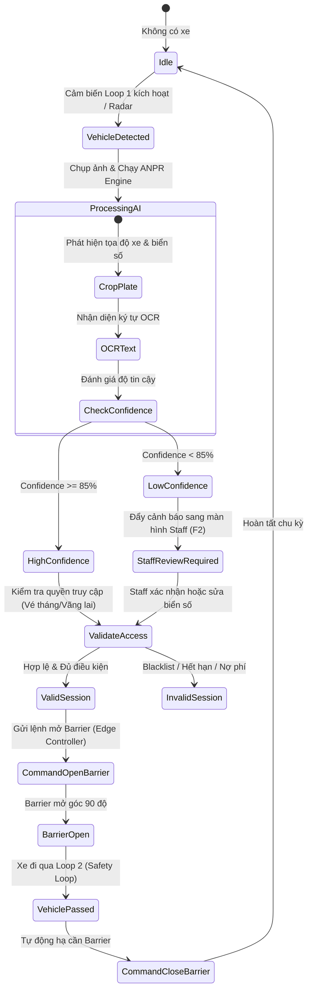

# SPM – MASTER UI/UX SPECIFICATION
**Hệ sinh thái Smart Parking Management (Enterprise Hybrid Cloud + Edge AI)**
*Document Version: 1.0.0 | Date: 2026-11-19 | Target Platforms: Next.js Web Admin, React Web Staff, Flutter Mobile (Customer & Guard)*

---

## 1. NGUYÊN TẮC HỆ THỐNG THIẾT KẾ (DESIGN SYSTEM FOUNDATIONS)

### 1.1. Bảng màu chuẩn hóa (Design Tokens & Color Palette)
Hệ thống sử dụng phong cách **Enterprise High-Tech Control Room (Dark Mode ưu tiên cho Giám sát/Staff bốt bảo vệ)** kết hợp **Modern Clean SaaS (Light/Dark Mode cho Quản trị viên Web Admin và Customer Mobile)**.

```css
/* Design Tokens - Tailwind CSS & Flutter Theme Definition */
:root {
  /* Brand Primary & Accents */
  --color-primary-50:  #EFF6FF;
  --color-primary-500: #3A86FF; /* Primary Action */
  --color-primary-600: #2563EB;
  --color-primary-700: #1D4ED8;
  
  --color-accent-cyan: #00F5D4; /* Realtime AI Tracking & Highlights */
  --color-accent-cyan-dark: #00BB9C;

  /* Dark Room / Control Center Surfaces */
  --color-navy-base:     #0B132B; /* Background toàn màn hình giám sát */
  --color-navy-surface:  #1C2541; /* Thẻ Card, Panel điều khiển */
  --color-navy-elevated: #243356; /* Dropdown, Dialog, Popover */
  --color-navy-border:   #334155; /* Đường viền phân cách */

  /* Neutral Light Surfaces (Admin Web & Mobile Light) */
  --color-neutral-50:  #F8FAFC;
  --color-neutral-100: #F1F5F9;
  --color-neutral-200: #E2E8F0;
  --color-neutral-800: #1E293B;
  --color-neutral-900: #0F172A;

  /* Semantic Feedback Tokens */
  --color-success: #10B981; /* Barrier Mở, Xe hợp lệ, Khớp biển số */
  --color-warning: #F59E0B; /* Cần kiểm tra thủ công, Confidence < 85%, Chưa thanh toán */
  --color-danger:  #EF4444; /* Barrier Lỗi, Biển số Đen, Bám đuôi, Mất kết nối */
  --color-info:    #0EA5E9; /* Thông tin trạng thái thường */
}
```

### 1.2. Hệ thống lưới & Spacing (8pt Grid System)
- Tất cả padding, margin, kích thước phần tử bắt buộc tuân thủ bội số của **8px** (với 4px dành cho vi mô):
  - `space-1` = 4px (micro gap: icon - text inline)
  - `space-2` = 8px (element internal padding: tags, chips, input small)
  - `space-3` = 12px (intermediate padding)
  - `space-4` = 16px (standard card padding, form group gap)
  - `space-6` = 24px (panel container padding, grid column gap)
  - `space-8` = 32px (section separator)
  - `space-12` = 48px (major page layout division)

### 1.3. Thang Typographic (Typography Scale)
- Font chữ chủ đạo: **Inter** hoặc **Plus Jakarta Sans** (cho Web), **Roboto / SF Pro** (cho Mobile).
- Số & Biển số xe: **JetBrains Mono** hoặc font chữ đơn cách (Monospace) in hoa để tối ưu khả năng đọc biển số xe không bị nhầm lẫn giữa `0` và `O`, `1` và `I`, `8` và `B`.
- Scale:
  - `text-display` (32px / line-height 40px, Bold) - Tổng tiền, Số xe tại bãi lớn
  - `text-h1` (24px / line-height 32px, SemiBold) - Tiêu đề trang chính
  - `text-h2` (20px / line-height 28px, SemiBold) - Tiêu đề card / module
  - `text-h3` (16px / line-height 24px, Medium) - Tiêu đề bảng / modal header
  - `text-body` (14px / line-height 20px, Regular) - Văn bản giao diện chính
  - `text-sm` (12px / line-height 16px, Regular) - Nhãn phụ, thời gian, mô tả
  - `text-plate` (22px, Monospace Bold, Tracking +2px) - Hiển thị biển số xe nhận diện

### 1.4. Tiêu chuẩn Thư viện Component (Modern Component Guidelines)
- **Web Frontend:** Next.js + Tailwind CSS + **Shadcn/ui** (xây dựng trên Radix UI Primitives).
- **Iconography:** Lucide Icons (SVG nhẹ, stroke-width 1.75px).
- **Bóng đổ (Elevation):** Sử dụng bóng đổ đa lớp mềm mại (`shadow-sm`, `shadow-md`, `shadow-xl`) với viền `border border-border/40`.
- **Bo góc (Radius):** `rounded-lg` (8px) cho input/button, `rounded-xl` (12px) cho card, `rounded-2xl` (16px) cho modal.
- **Trạng thái Micro-Interactions:**
  - Nút bấm: hiệu ứng hover nhẹ, active co lại `scale-[0.98]`, focus visible outline xanh 2px.
  - Loading: Skeleton shimmer component thay vì spinner đơn điệu.
  - Camera live: Đèn pulsing badge màu xanh lá khi stream bình thường, đỏ khi ngắt luồng.

---

## 2. KIẾN TRÚC ĐIỀU HƯỚNG & LAYOUT TỔNG THỂ

### 2.1. Web Admin (Super Admin & Organization Admin)
- **Layout:** Cấu trúc 3 vùng:
  1. **Collapsible Sidebar (Trái):** Logo, bộ chọn Doanh nghiệp / Bãi xe (Tenant/Site Switcher), danh mục menu phân nhóm có badge số thông báo lỗi/cảnh báo.
  2. **Top Navigation Header:** Breadcrumb động, thanh tìm kiếm toàn cầu (Cmd+K), chuông thông báo (Realtime WebSocket alerts), bộ chuyển đổi theme, user avatar & role badge.
  3. **Main Content Canvas:** Container có khả năng co giãn tối đa (Fluid Container), hỗ trợ chia lưới Card Widget từ 1 cột (Mobile/Tablet) đến 4 cột (Desktop 2K/4K).

### 2.2. Web Staff (Bốt kiểm soát / Cabin bãi xe)
- **Layout đặc thù:** Tối ưu hóa cho màn hình 21" - 27" tại bốt trực.
- **Màn hình chia đôi hoặc chia 4 (Split-view Lane Matrix):**
  - Cột trái: Luồng Camera Làn Vào (Live Camera toàn cảnh + Live Camera Biển số + Khung OCR nhận diện + Kết quả xác minh).
  - Cột phải: Luồng Camera Làn Ra (Live Camera Biển số + Hình ảnh xe lúc Vào để so sánh đối chiếu trực tiếp + Bảng tính cước cước phí tự động + Nút thu tiền/xác nhận QR).
- **Thanh trạng thái khẩn cấp (Emergency Bar):** Nút mở barrier cưỡng bức, phím tắt nhanh (`SPACE` = Mở barrier, `F2` = Sửa biển số, `F4` = Thu tiền mặt).

### 2.3. Customer Mobile App (Flutter)
- **Layout:** Cấu trúc chuẩn Touch-friendly:
  1. **Bottom Navigation Bar (5 tabs):** Trang chủ (Home), Tìm bãi xe (Find Parking), Thẻ xe / Lượt đỗ hiện tại (Pass/Active Session), Vé tháng (Subscriptions), Cá nhân (Profile).
  2. **Hero Active Card:** Thẻ hiển thị phiên gửi xe đang đỗ ngay đầu trang chủ (Thời gian đã đỗ, Chi phí tạm tính, Nút thanh toán trước khi lấy xe).
  3. **Floating Action Button (FAB):** Nút quét mã QR thanh toán nhanh hoặc mở thẻ gửi xe điện tử (Digital Ticket).

---

## 3. DANH MỤC MÀN HÌNH CHI TIẾT – WEB ADMIN SUPER ADMIN (24 MÀN HÌNH)

| STT | Mã màn hình | Tên màn hình | Thành phần giao diện (UI Components) | Bộ lọc & Tác vụ chính |
|---|---|---|---|---|
| 01 | SA-AUTH-01 | Đăng nhập Super Admin | Card form giữa màn hình, Email, Password, Nút Đăng nhập, Link Quên MK, Captcha chống brute-force | Submit form, Kiểm tra thiết bị lạ |
| 02 | SA-AUTH-02 | Quên mật khẩu | Input Email khôi phục, Nút gửi link reset, Hướng dẫn bảo mật | Gửi mail token có hiệu lực 15 phút |
| 03 | SA-AUTH-03 | Xác thực 2 bước (MFA) | 6 ô nhập mã OTP (TOTP Authenticator), Bộ đếm ngược 60s, Gửi lại SMS/Email dự phòng | Auto-focus, Auto-submit khi đủ 6 ký tự |
| 04 | SA-DASH-01 | Global Executive Dashboard | 4 KPI Cards: Tổng Tenant, Tổng Bãi xe, Doanh thu hệ thống, Thiết bị Online. Bản đồ phân bổ vị trí các bãi xe (Mapbox/Google Maps), Biểu đồ đường lưu lượng xe theo giờ, Widget sự cố khẩn cấp | Filter theo vùng miền, khoảng thời gian (Hôm nay, Tuần, Tháng, Năm). Xuất báo cáo tổng quan |
| 05 | SA-ORG-01 | Danh sách Doanh nghiệp | Data Table: Mã DN, Tên, Gói SaaS, Ngày hết hạn, Số bãi xe, Số camera, Trạng thái (Active/Suspended), Cột Actions | Search tên/mã, Lọc theo Gói thuê bao, Lọc theo Trạng thái. Nút "Tạo Doanh nghiệp mới" |
| 06 | SA-ORG-02 | Chi tiết Doanh nghiệp | Tab layout: 1. Thông tin chung; 2. Danh sách bãi xe; 3. Hợp đồng & Thanh toán; 4. Quản trị viên DN; 5. Giới hạn tài nguyên (Quota) | Chỉnh sửa thông tin, Nâng cấp gói, Tạm khóa tài khoản Tenant, Đặt lại mật khẩu Admin DN |
| 07 | SA-ORG-03 | Tạo Doanh nghiệp mới | Multi-step Form (3 bước): B1: Thông tin pháp nhân; B2: Chọn gói cước & Quota tài nguyên; B3: Tạo tài khoản Org Admin ban đầu | Form validation realtime, kiểm tra trùng lặp mã số thuế/email |
| 08 | SA-PLAN-01 | Cấu hình Gói dịch vụ SaaS | Bảng so sánh các gói (Starter, Professional, Enterprise). Danh sách tính năng bật/tắt dạng Switch toggle, Giá thuê bao theo tháng/năm | Tạo gói mới, chỉnh sửa giá cước, cấu hình giới hạn số bãi/làn/camera |
| 09 | SA-BILL-01 | Quản lý Thuê bao & Hóa đơn | Bảng lịch sử thanh toán SaaS của các Tenant, trạng thái thanh toán (Paid, Overdue, Pending), Hóa đơn điện tử PDF | Lọc theo thời hạn hợp đồng, xuất danh sách công nợ thuê bao, gửi email nhắc gia hạn tự động |
| 10 | SA-SITE-01 | Danh mục Bãi xe toàn cầu | Data Table: Tên bãi, Doanh nghiệp chủ quản, Địa chỉ, Loại hình (Chung cư/TTTM/Bệnh viện), Tổng làn, Trạng thái kết nối Edge | Lọc theo Doanh nghiệp, Khu vực địa lý, Trạng thái Online/Offline |
| 11 | SA-SITE-02 | Giám sát sức khỏe Bãi xe | Sơ đồ cây thiết bị bãi xe: Edge Node Gateway, IPC Camera, Bộ điều khiển Barrier. Bảng latency ping, Băng thông dữ liệu đồng bộ | Nút kiểm tra kết nối từ xa (Remote Ping), Nút khởi động lại Edge Agent |
| 12 | SA-DEV-01 | Sổ đăng ký Thiết bị toàn cầu | Danh sách toàn bộ phần cứng trên hệ thống: Serial Number, MAC, Chủng loại (Hikvision, Dahua, ZKTeco, Hanwha), Phiên bản Firmware | Lọc theo Hãng, Loại thiết bị, Trạng thái Firmware. Cập nhật OTA hàng loạt |
| 13 | SA-AI-01 | Quản lý Động cơ & Mô hình AI | Bảng quản lý Model AI: Tên model (YOLOv8-ANPR-VN, Plate-OCR-v2), Version, Ngày phát hành, Tỷ lệ chính xác benchmark | Tải lên model weights mới (.onnx, .engine), Gán model cho các Edge Box theo zone |
| 14 | SA-AI-02 | Chi tiết & Giám sát AI Model | Biểu đồ Inference Latency (P50, P95, P99), Tỷ lệ nhận diện thành công theo thời gian, Ma trận nhầm lẫn (Confusion Matrix) | Rollback model về phiên bản trước, Tải logs kiểm thử mẫu |
| 15 | SA-MON-01 | Giám sát Hạ tầng Nền tảng | Grafana Embedded Dashboard: CPU, RAM, Disk của Cloud Clusters, Tốc độ xử lý hàng đợi RabbitMQ, Trạng thái Database Read/Write | Xem metrics realtime, Thiết lập ngưỡng cảnh báo quá tải server |
| 16 | SA-ALT-01 | Cảnh báo Hệ thống Toàn cầu | Feed cảnh báo: Mức độ (Critical, Warning, Info), Nguồn lỗi (Cloud API, Edge Node, MQTT Broker), Thời gian phát sinh | Lọc theo mức độ nghiêm trọng, gán ticket xử lý, đóng cảnh báo |
| 17 | SA-IAM-01 | Quản lý Người dùng Toàn cầu | Danh sách toàn bộ tài khoản quản trị hệ thống, Trạng thái MFA, Lần đăng nhập cuối, IP đăng nhập gần nhất | Tìm kiếm, Khóa tài khoản, Bắt buộc đăng xuất toàn bộ thiết bị, Reset mật khẩu |
| 18 | SA-IAM-02 | Quản lý Vai trò (Roles) | Danh sách vai trò hệ thống: Super Admin, Tech Support, Billing Specialist, AI Operations. Cây phân quyền Permission Tree | Tạo vai trò mới, gán chính sách quyền hạn chi tiết |
| 19 | SA-IAM-03 | Phân quyền chi tiết (RBAC) | Ma trận quyền hạn dạng bảng chéo: Module vs Quyền (Create, Read, Update, Delete, Execute) | Bật/tắt quyền bằng checkbox, lưu policy JSON |
| 20 | SA-AUD-01 | Nhật ký Hoạt động (Audit Logs) | Bảng lịch sử bất biến: Timestamp, User ID, Địa chỉ IP, Hành động (ACTION_OPEN_BARRIER, UPDATE_CONFIG), Payload trước & sau | Lọc theo Người dùng, Loại hành động, Khoảng ngày. Xuất file CSV kiểm toán |
| 21 | SA-API-01 | Quản lý Khóa API & Webhooks | Danh sách API Keys cấp cho đối tác bên thứ ba (ERP, Tòa nhà, Cổng thanh toán), Tỷ lệ gọi API, Giới hạn Rate limit | Tạo API Key mới, Thu hồi key (Revoke), Cấu hình Webhook URL & Secret Signature |
| 22 | SA-INT-01 | Quản lý Tích hợp Hệ thống | Thẻ cấu hình các cổng tích hợp: VNPT e-Invoice, Viettel Pay, MoMo, ZaloPay, SMS Brandname, Email SMTP | Test kết nối cổng thanh toán, xem nhật ký trao đổi dữ liệu |
| 23 | SA-SYS-01 | Cấu hình Tổng thể Nền tảng | Form cấu hình: Tên thương hiệu, Logo hệ thống, Múi giờ mặc định, Ngôn ngữ, Chính sách lưu trữ dữ liệu (Data Retention Days) | Lưu cấu hình, Tải lên tệp chứng chỉ SSL |
| 24 | SA-BCK-01 | Sao lưu & Phục hồi Dữ liệu | Lịch trình sao lưu tự động (Daily Snapshots), Danh sách bản backup trên S3/MinIO, Kích thước file, Trạng thái toàn vẹn | Tạo bản snapshot thủ công, Kích hoạt quy trình phục hồi khẩn cấp (Disaster Recovery) |

---

## 4. DANH MỤC MÀN HÌNH CHI TIẾT – WEB ADMIN ORGANIZATION ADMIN (52 MÀN HÌNH)

### 4.1. Phân nhóm Vận hành & Sơ đồ bãi xe
| STT | Mã màn hình | Tên màn hình | Chi tiết giao diện & Tính năng |
|---|---|---|---|
| 01 | OA-DASH-01 | Org Dashboard | Tổng quan toàn bộ các bãi xe thuộc doanh nghiệp: Doanh thu hôm nay, Số lượt xe vào/ra, Công suất lấp đầy hiện tại, Cảnh báo chưa xử lý. |
| 02 | OA-SITE-01 | Danh sách Bãi xe | Danh sách bãi đỗ xe thuộc quyền quản lý, địa chỉ, số lượng làn vào/ra, tổng chỗ đỗ. |
| 03 | OA-SITE-02 | Tạo & Thiết lập Bãi xe | Form nhập tên bãi, tọa độ GPS, giờ mở/đóng cửa, quy chế tính phí mặc định, upload quy định nội bộ. |
| 04 | OA-SITE-03 | Chi tiết Vận hành Bãi xe | Báo cáo chi tiết từng bãi: lưu lượng theo khung giờ, thống kê loại xe (ô tô, xe máy, xe điện), doanh thu lũy kế. |
| 05 | OA-LAY-01 | Sơ đồ Bãi xe (Visual Map) | Bản đồ số (Digital Twin) 2D trực quan thể hiện phân khu, vị trí đỗ, đường đi của xe. Trạng thái tô màu (Xanh: Trống, Đỏ: Đang đỗ, Vàng: Đã đặt trước). |
| 06 | OA-LAY-02 | Quản lý Tầng (Floors) | Danh sách tầng đỗ xe (Hầm B1, Hầm B2, Tầng 1, Tầng 2...), cấu hình giới hạn chiều cao xe cho từng tầng. |
| 07 | OA-LAY-03 | Quản lý Khu vực (Zones) | Phân vùng khu vực: Khu VIP, Khu xe cư dân, Khu khách vãng lai, Khu sạc xe điện EV. |
| 08 | OA-LAY-04 | Quản lý Vị trí đỗ (Slots) | Danh sách từng ô đỗ xe cụ thể, gắn mã ô (VD: B1-A12), gán cảm biến đỗ xe siêu âm tương ứng. |
| 09 | OA-LANE-01 | Danh mục Làn xe | Danh sách tất cả các làn vào/ra của bãi, trạng thái hoạt động (Mở, Đóng làn, Bảo trì). |
| 10 | OA-LANE-02 | Cấu hình Thiết bị Làn xe | Giao diện gán thiết bị cho làn: Chọn Camera ANPR biển số, Camera góc rộng, Cổng điều khiển Barrier (IP/Port), Máy in vé, Bảng LED. |

### 4.2. Phân nhóm Phương tiện, Nhận diện AI & Khách hàng
| STT | Mã màn hình | Tên màn hình | Chi tiết giao diện & Tính năng |
|---|---|---|---|
| 11 | OA-VEH-01 | Danh mục Phương tiện | Bảng dữ liệu: Biển số, Loại xe, Chủ xe, Mã thẻ/Mã định danh, Nhóm xe (Vé tháng, Khách vãng lai, VIP, Xe công vụ). |
| 12 | OA-VEH-02 | Chi tiết Phương tiện | Lịch sử toàn bộ các lần gửi xe, ảnh chụp xe các lần vào ra, hợp đồng vé tháng liên quan, ghi chú vi phạm nội quy. |
| 13 | OA-CRM-01 | Danh bạ Khách hàng | Quản lý danh sách khách hàng/cư dân: Họ tên, Số điện thoại, Căn hộ/Phòng ban, Danh sách phương tiện đăng ký. |
| 14 | OA-CRM-02 | Hồ sơ Chi tiết Khách hàng | Thông tin chi tiết, lịch sử giao dịch thanh toán, các lượt khiếu nại đã gửi và tiến độ giải quyết. |
| 15 | OA-SESS-01 | Nhật ký Lượt gửi xe (Sessions) | Bảng trung tâm: Session ID, Biển số vào, Biển số ra, Thời gian vào, Thời gian ra, Thời lượng đỗ, Tổng cước, Trạng thái (Đang gửi, Đã hoàn tất, Cần duyệt). |
| 16 | OA-SESS-02 | Chi tiết Lượt gửi xe | Modal/Trang so sánh 2 ảnh: Ảnh chụp lúc vào (biển số + toàn cảnh) và Ảnh chụp lúc ra, thông số AI confidence, lịch sử mở barrier. |
| 17 | OA-SESS-03 | Xử lý Ngoại lệ Phiên đỗ xe | Danh sách các phiên lỗi: Xe vào không có biển, Xe ra không khớp biển vào, Xe đỗ quá 72 giờ không có liên lạc. |
| 18 | OA-AI-01 | Nhật ký Nhận diện AI ANPR | Danh sách raw events từ camera AI: Ảnh crop biển số, Ký tự OCR trích xuất, Độ tin cậy (Confidence score: 0-100%). |
| 19 | OA-AI-02 | Cấu hình Ngưỡng AI ANPR | Thiết lập vùng nhận diện ROI (Region of Interest) trên khung hình camera, chỉnh ngưỡng tin cậy tối thiểu để tự động mở cổng. |
| 20 | OA-AI-03 | Cấu hình Nhận diện Khuôn mặt | Bật/tắt chế độ xác thực khuôn mặt cho từng nhóm đối tượng (bắt buộc với cư dân, tùy chọn với khách), chỉnh ngưỡng liveness. |
| 21 | OA-AI-04 | Đánh giá Hiệu năng AI | Báo cáo tỷ lệ nhận diện chính xác, tỷ lệ phải sửa biển số thủ công theo từng góc camera để kỹ thuật căn chỉnh góc quay. |
| 22 | OA-BIO-01 | Quản lý Hồ sơ Sinh trắc học | Danh sách người dùng đã đăng ký khuôn mặt, mã hash vector embedding (tuyệt đối không lưu raw embedding không mã hóa). |
| 23 | OA-BIO-02 | Quản lý Đồng ý Thu thập (Consent) | Quản lý lịch sử ký chấp thuận xử lý dữ liệu sinh trắc học theo Luật Bảo vệ dữ liệu cá nhân VN, nút thu hồi consent và xóa dữ liệu. |

### 4.3. Phân nhóm Bảng giá, Vé tháng & Tài chính
| STT | Mã màn hình | Tên màn hình | Chi tiết giao diện & Tính năng |
|---|---|---|---|
| 24 | OA-PRC-01 | Danh mục Bảng giá | Danh sách các biểu phí đang áp dụng (Bảng giá ngày thường, Cuối tuần, Ngày lễ, Biểu phí lũy tiến theo block 30 phút). |
| 25 | OA-PRC-02 | Cấu hình Quy tắc Tính phí | Giao diện kéo thả/cấu hình công thức giá: Phí vào ban ngày, Phí qua đêm, Thời gian ân hạn miễn phí (Grace period, ví dụ < 15 phút không thu tiền). |
| 26 | OA-SUB-01 | Gói Vé tháng (Subscription Plans) | Danh mục các gói vé định kỳ: Vé tháng xe máy cư dân, Vé tháng ô tô văn phòng, Vé quý, Vé năm. |
| 27 | OA-SUB-02 | Quản lý Hợp đồng Vé tháng | Bảng theo dõi vé tháng: Mã hợp đồng, Khách hàng, Biển số gán kèm, Ngày kích hoạt, Ngày hết hạn, Tình trạng công nợ. |
| 28 | OA-PAY-01 | Lịch sử Giao dịch Thanh toán | Toàn bộ giao dịch: Mã thanh toán, Phương thức (Tiền mặt, VietQR, Thẻ tín dụng, Ví MoMo), Số tiền, Thời gian, Trạng thái. |
| 29 | OA-PAY-02 | Chi tiết Giao dịch | Chi tiết giao dịch ngân hàng, mã tham chiếu cổng thanh toán (Trace ID), biên lai thanh toán điện tử. |
| 30 | OA-PAY-03 | Quản lý Hoàn tiền (Refunds) | Danh sách yêu cầu hoàn cước đỗ xe (do trừ tiền 2 lần, xe vào rồi quay đầu ra ngay), phê duyệt hoàn tiền theo quy trình 2 cấp. |
| 31 | OA-PAY-04 | Báo cáo Đối soát Ngân hàng | So khớp giữa doanh thu ghi nhận trên hệ thống SPM và sao kê tài khoản ngân hàng thụ hưởng, phát hiện chênh lệch. |
| 32 | OA-INV-01 | Quản lý Xuất Hóa đơn Điện tử | Lịch sử xuất hóa đơn VAT theo Nghị định 123/Thông tư 78 cho khách hàng doanh nghiệp hoặc cá nhân có nhu cầu. |

### 4.4. Phân nhóm Thiết bị IoT, Giám sát Realtime & Cảnh báo
| STT | Mã màn hình | Tên màn hình | Chi tiết giao diện & Tính năng |
|---|---|---|---|
| 33 | OA-IOT-01 | Danh sách Thiết bị IoT | Quản lý toàn bộ thiết bị phần cứng tại bãi: Camera, Barrier, Vòng từ, Cảm biến, Màn hình LED, Máy POS cầm tay. |
| 34 | OA-IOT-02 | Chi tiết Thiết bị | Thông số cấu hình mạng IP, cổng RTSP, trạng thái kết nối mạng LAN/Edge, lịch sử bảo dưỡng thiết bị. |
| 35 | OA-CAM-01 | Quản lý Camera | Cấu hình camera: Preset góc nhìn, điều chỉnh độ phơi sáng ban đêm, thông số luồng phụ (Sub-stream) để tối ưu băng thông. |
| 36 | OA-BAR-01 | Quản lý Cần Barrier | Cấu hình bộ điều khiển barrier: Thời gian tự động hạ cần sau khi xe qua vòng từ loop 2, chế độ mở khẩn cấp khi mất điện. |
| 37 | OA-EDG-01 | Quản lý Node Edge Gateway | Tình trạng máy chủ Edge tại bãi: Nhiệt độ CPU, Dung lượng ổ cứng lưu trữ video/ảnh cục bộ, Thời gian đồng bộ gần nhất lên Cloud. |
| 38 | OA-DEV-02 | Bảng Sức khỏe Thiết bị | Dashboard realtime hiển thị các thiết bị đang có dấu hiệu suy giảm tín hiệu (Mất gói ping, FPS camera giảm < 15 fps). |
| 39 | OA-MON-01 | Live Monitoring Tổng quan | Màn hình ghép camera (Video Wall 4x4 hoặc 3x3) trực tiếp tất cả các làn vào ra của doanh nghiệp với độ trễ thấp. |
| 40 | OA-MON-02 | Giám sát Làn chi tiết | Xem cận cảnh 1 làn xe cụ thể: Luồng camera mượt mà kèm overlay khung AI biển số, trạng thái đóng mở của barrier theo giây. |
| 41 | OA-ALT-01 | Trung tâm Xử lý Cảnh báo | Danh sách cảnh báo: Xe khả nghi, Biển số giả mạo, Cạy cần barrier, Thiết bị mất nguồn, Bám đuôi (Tailgating). |
| 42 | OA-ALT-02 | Quản lý Sự cố & Ticket | Tiếp nhận và phân công nhân viên kỹ thuật xử lý sự cố thiết bị hoặc khiếu nại khách hàng, theo dõi SLA xử lý. |

### 4.5. Phân nhóm Báo cáo Thống kê, Nhân sự & Cấu hình
| STT | Mã màn hình | Tên màn hình | Chi tiết giao diện & Tính năng |
|---|---|---|---|
| 43 | OA-REP-01 | Báo cáo Doanh thu | Biểu đồ cột/đường doanh thu theo ngày, tuần, tháng, phân tích doanh thu theo từng làn và theo phương thức thanh toán. |
| 44 | OA-REP-02 | Phân tích Tải trọng & Chỗ đỗ | Biểu đồ nhiệt (Heatmap) tỷ lệ lấp đầy các tầng hầm theo giờ trong ngày, dự báo giờ cao điểm để bố trí nhân sự. |
| 45 | OA-REP-03 | Báo cáo Hiệu năng AI | Thống kê số lượng lượt xe tự động thông quan 100% không cần can thiệp con người vs số lượt nhân viên phải xác nhận. |
| 46 | OA-STF-01 | Danh sách Nhân viên Bãi xe | Quản lý tài khoản nhân viên bảo vệ, thu ngân, kỹ thuật viên: Họ tên, Số điện thoại, Ca trực phụ trách. |
| 47 | OA-STF-02 | Quản lý Phân ca Trực | Lịch xếp ca (Ca sáng, Ca chiều, Ca đêm) cho các bốt kiểm soát, ghi nhận thời gian chấm công vào/ra ca. |
| 48 | OA-IAM-01 | Phân quyền Nội bộ Doanh nghiệp | Cấu hình nhóm quyền cho nhân viên (Chỉ được mở cổng khi có sự đồng ý của trưởng ca, không được sửa giá cước). |
| 49 | OA-AUD-01 | Nhật ký Thao tác Nhân viên | Ghi nhận chi tiết: Nhân viên nào bấm nút mở barrier thủ công lúc mấy giờ, lý do mở cổng bắt buộc phải nhập. |
| 50 | OA-SET-01 | Cấu hình Thông báo | Cấu hình kênh nhận thông báo khẩn cấp: Telegram Bot, Zalo ZNS, Email hoặc SMS khi bãi xe có sự cố nghiêm trọng. |
| 51 | OA-SET-02 | Cấu hình Tích hợp Bãi xe | Kết nối với hệ thống quản lý tòa nhà BMS, phần mềm kế toán doanh nghiệp, phần mềm chấm công nhân viên. |
| 52 | OA-SET-03 | Cài đặt Doanh nghiệp | Cập nhật thông tin công ty, logo hiển thị trên vé in nhiệt và hóa đơn, thiết lập múi giờ và tiền tệ mặc định. |

---

## 5. DANH MỤC MÀN HÌNH CHI TIẾT – WEB STAFF (CABIN BỐT TRỰC - 22 MÀN HÌNH/MODES)

Giao diện Web Staff được thiết kế theo chuẩn **Ergonomic Operator Workspace**: Tông màu tối bảo vệ mắt cho bảo vệ ca đêm, các nút thao tác to bản, hỗ trợ 100% phím tắt không cần dùng chuột.

```
+------------------------------------------------------------------------------------------------------+
| [SPM STAFF WORKSTATION] - BÃI XE TÒA NHÀ LANDMARK 81 - CA SÁNG (BẢO VỆ: NGUYỄN VĂN A) - [ONLINE]      |
+---------------------------------------------------+--------------------------------------------------+
|                     LÀN VÀO 01                    |                    LÀN RA 01                     |
| +-----------------------------------------------+ | +----------------------------------------------+ |
| | [LIVE RTSP STREAM - CAMERA TOÀN CẢNH]         | | | [LIVE RTSP STREAM - CAMERA TOÀN CẢNH]        | |
| |                                               | | |                                              | |
| +-----------------------------------------------+ | +----------------------------------------------+ |
| | [LIVE RTSP STREAM - CAMERA BIỂN SỐ AI]        | | | [LIVE RTSP STREAM - CAMERA BIỂN SỐ AI]       | |
| |  [Bounding Box: 51H-987.65 | Conf: 98.4%]     | | |  [Bounding Box: 51H-987.65 | Conf: 97.8%]    | |
| +-----------------------------------------------+ | +----------------------------------------------+ |
| | THÔNG TIN XE VÀO:                             | | | ĐỐI CHIẾU ẢNH LÚC VÀO & LÚC RA:              | |
| | Biển số: 51H - 987.65 (XE Ô TÔ 5 CHỖ)         | | | Lúc vào: 08:15:20 | Lúc ra: 14:30:10 (6h 15m)| |
| | Phân loại: Vé tháng cư dân (HỢP LỆ)           | | | Phí đỗ xe: 50.000 VNĐ                        | |
| | Barrier Vào: ĐÃ MỞ TỰ ĐỘNG                    | | | Thanh toán: [ĐÃ QUÉT VIETQR THÀNH CÔNG]      | |
| +-----------------------------------------------+ | +----------------------------------------------+ |
| [F1: Mở Barrier Vào] [F2: Sửa Biển] [F3: Bỏ qua]| [SPACE: MỞ BARRIER RA] [F4: Thu Tiền Mặt] [ESC]  |
+---------------------------------------------------+--------------------------------------------------+
| PHÍM TẮT: [SPACE: Mở Cổng Ra] [F1: Mở Cổng Vào] [F2: Sửa Biển Số] [F4: Thu Tiền Mặt] [F9: Báo Động]   |
+------------------------------------------------------------------------------------------------------+
```

| STT | Mã màn hình | Tên màn hình | Chức năng & Tương tác bàn phím |
|---|---|---|---|
| 01 | STF-AUTH-01 | Đăng nhập Bốt trực | Đăng nhập nhanh bằng Mã nhân viên + PIN 6 số hoặc quẹt thẻ nhân viên RFID. |
| 02 | STF-DASH-01 | Tổng quan Ca trực | Hiển thị: Tổng số lượt xe phục vụ trong ca, Số tiền mặt đang giữ trong két, Số sự cố đã xử lý. |
| 03 | STF-LANE-01 | Màn hình Điều khiển Làn đôi (Split View) | Màn hình chính làm việc: hiển thị song song Làn Vào và Làn Ra, cập nhật video độ trễ < 300ms. |
| 04 | STF-CAM-01 | Chế độ Phóng to Camera Làn | Nhấp đúp vào bất kỳ camera nào để phóng toàn màn hình kiểm tra chi tiết gầm xe hoặc nóc xe container. |
| 05 | STF-IN-01 | Chi tiết Lượt xe Vào | Xem ảnh chụp chi tiết góc rộng, ảnh crop biển số, thông tin phân loại xe tự động từ AI. |
| 06 | STF-OUT-01 | Chi tiết Lượt xe Ra & Thu phí | Hiển thị bảng đối chiếu ảnh vào - ảnh ra, thời gian gửi, biểu đồ cước phí tự động. |
| 07 | STF-REV-01 | Modal Sửa Biển số Nhanh (F2) | Phím tắt `F2`: Bật hộp thoại nhập tay biển số khi AI đọc sai do biển số dính bùn đất hoặc bị che khuất. |
| 08 | STF-SRCH-01 | Tra cứu Phương tiện trong bãi | Ô tìm kiếm nhanh: gõ 3-4 số cuối biển số để tìm xem xe đang đỗ ở vị trí nào và vào lúc mấy giờ. |
| 09 | STF-SESS-01 | Tra cứu Lượt gửi xe lịch sử | Xem lại các lượt gửi xe vừa hoàn tất trong vòng 1-2 tiếng trước để kiểm tra lại khi khách khiếu nại. |
| 10 | STF-MAN-IN | Tạo Lượt vào Thủ công | Áp dụng khi camera hỏng hoặc xe đặc chủng không có biển số (xe nâng, máy kéo công trình). |
| 11 | STF-MAN-OUT | Xử lý Lượt ra Thủ công | Áp dụng khi khách mất vé/không quét được mã, cho phép đối soát theo thời gian ước lượng của khách. |
| 12 | STF-PAY-CSH | Thu Tiền mặt & In Biên lai | Phím tắt `F4`: Xác nhận khách trả tiền mặt, hệ thống gửi lệnh mở barrier và kích hoạt máy in nhiệt in biên lai. |
| 13 | STF-PAY-QR | Hiển thị QR Thanh toán Động | Màn hình phụ hướng ra phía tài xế tự động tạo mã VietQR theo số tiền chính xác để tài xế chuyển khoản. |
| 14 | STF-BAR-CTL | Điều khiển Barrier Cưỡng bức | Phím tắt `SPACE` (Làn Ra) / `F1` (Làn Vào): Mở barrier thủ công khi có sự cố, yêu cầu nhập lý do nhanh. |
| 15 | STF-EXC-01 | Trung tâm Xử lý Bất thường | Danh sách các tình huống cảnh báo đang chờ nhân viên bốt giải quyết trước khi cho xe đi. |
| 16 | STF-EXC-02 | Xử lý Mất Lượt vào (Lost Session) | Quy trình kiểm tra đối soát video bãi xe để xác định thời điểm thực tế xe vào bãi nhằm tính đúng giá cước. |
| 17 | STF-EXC-03 | Xử lý Lệch Biển số (Plate Mismatch) | Cảnh báo đỏ nhấp nháy khi xe mang biển số khác với dữ liệu nhận diện ban đầu, hỗ trợ so sánh ảnh. |
| 18 | STF-INC-01 | Tạo Báo cáo Sự cố Hiện trường | Ghi nhanh biên bản sự cố va quẹt barrier, tài xế không chịu trả phí hoặc gây rối trật tự tại làn. |
| 19 | STF-SHIFT-01 | Biên bản Bàn giao Ca trực | Tổng kết ca trực: Số xe ô tô/xe máy đã xử lý, tổng tiền mặt bàn giao cho ca sau, ký nhận điện tử trên màn hình. |
| 20 | STF-SHIFT-02 | Báo cáo Doanh thu Ca | In phiếu tổng kết doanh thu ca trực ra giấy in bill nhiệt 80mm để bàn giao cho thủ quỹ. |
| 21 | STF-ALT-01 | Danh sách Cảnh báo Bốt trực | Cảnh báo âm thanh (Beep sound) khi phát hiện xe trong danh sách đen hoặc phát hiện người đi bộ cắt ngang làn xe. |
| 22 | STF-PRF-01 | Thông tin Nhân viên & Đổi Ca | Xem ca trực tiếp theo của mình, yêu cầu đổi ca trực với đồng nghiệp khác. |

---

## 6. DANH MỤC MÀN HÌNH CHI TIẾT – CUSTOMER MOBILE APP (FLUTTER - 30 MÀN HÌNH)

Ứng dụng hướng đến người lái xe với triết lý **"Zero Friction Parking" - Đỗ xe không chạm**:

| STT | Mã màn hình | Tên màn hình | Các thành phần UI cốt lõi & Luồng trải nghiệm người dùng |
|---|---|---|---|
| 01 | MOB-SPL-01 | Splash Screen | Logo hoạt họa thương hiệu SPM, tự động kiểm tra phiên đăng nhập Token và kết nối mạng. |
| 02 | MOB-ONB-01 | Onboarding Slides | 3 slides giới thiệu: 1. Đỗ xe không cần vé giấy; 2. Thanh toán tự động qua mã QR; 3. Tìm chỗ trống thông minh. |
| 03 | MOB-AUTH-01 | Đăng nhập Khách hàng | Đăng nhập bằng Số điện thoại + OTP hoặc Đăng nhập nhanh qua Apple ID / Google Sign-In / Sinh trắc học máy (Biometrics). |
| 04 | MOB-AUTH-02 | Đăng ký Tài khoản | Nhập Họ tên, Số điện thoại, Email, Mật khẩu bảo mật, Checkbox đồng ý Điều khoản dịch vụ. |
| 05 | MOB-AUTH-03 | Xác thực OTP Điện thoại | Nhập mã OTP 6 số từ SMS/Zalo ZNS, tính năng tự động điền mã (Auto-fill SMS code). |
| 06 | MOB-HOME-01 | Trang chủ (Home Feed) | **Thẻ Active Parking Pass nổi bật:** Hiển thị vị trí xe đang đỗ, bộ đếm thời gian thực, số tiền hiện tại. Thanh tìm kiếm bãi xe lân cận. Lối tắt nhanh nạp tiền vé tháng. |
| 07 | MOB-PRF-01 | Hồ sơ Người dùng | Ảnh đại diện, Thông tin liên lạc, Điểm thưởng thành viên, Lối tắt cài đặt bảo mật và quyền riêng tư. |
| 08 | MOB-VEH-01 | Danh sách Xe của tôi | Danh sách các phương tiện đã đăng ký (Xe ô tô, Xe máy) kèm ảnh chụp xe, trạng thái kích hoạt vé tháng. |
| 09 | MOB-VEH-02 | Đăng ký Thêm Xe mới | Chụp ảnh Giấy đăng ký xe (Cà vẹt xe) để tự động trích xuất biển số qua AI OCR, chọn loại phương tiện và màu sắc. |
| 10 | MOB-VEH-03 | Chi tiết Phương tiện | Xem lịch sử toàn bộ các chuyến gửi xe của chiếc xe này, tình trạng vé tháng và mã định danh RFID gắn kèm. |
| 11 | MOB-BIO-01 | Đăng ký Khuôn mặt (Tự nguyện) | Trải nghiệm quét khuôn mặt 3D theo vòng tròn (3D Face Mesh), hướng dẫn quay trái/phải, kiểm tra liveness chống ảnh giả. |
| 12 | MOB-BIO-02 | Quản lý Đồng ý Riêng tư | Màn hình minh bạch giải thích rõ dữ liệu khuôn mặt chỉ dùng để xác thực mở barrier, cho phép người dùng bấm "Rút lại đồng ý & Xóa vĩnh viễn dữ liệu khuôn mặt". |
| 13 | MOB-MAP-01 | Tìm kiếm Bãi xe lân cận | Bản đồ tương tác hiển thị các bãi xe xung quanh vị trí hiện tại kèm số chỗ trống realtime (VD: "Còn 15 chỗ ô tô"), giá đỗ xe theo giờ. |
| 14 | MOB-MAP-02 | Chi tiết Bãi đỗ xe | Hình ảnh bãi xe, Đánh giá sao, Giờ mở cửa, Bảng giá chi tiết, Tiện ích (Có trạm sạc xe điện, Rửa xe, Mái che), Nút chỉ đường (Google Maps / Apple Maps). |
| 15 | MOB-MAP-03 | Sơ đồ Chỗ trống Realtime | Xem bản đồ sơ đồ tầng hầm của bãi xe, vị trí các ô trống còn lại để lái xe chủ động chạy thẳng tới ô trống. |
| 16 | MOB-RES-01 | Đặt chỗ trước (Reservation) | Chọn bãi xe, chọn thời gian đến dự kiến, chọn vị trí đỗ mong muốn, thanh toán tiền cọc giữ chỗ. |
| 17 | MOB-PASS-01 | Thẻ Gửi xe Điện tử (Active) | Thẻ gửi xe kỹ thuật số với mã QR động thay đổi mỗi 30 giây (chống chụp màn hình gian lận), hiển thị ảnh chụp lúc xe vào bãi. |
| 18 | MOB-HIST-01 | Lịch sử Đỗ xe | Danh sách các chuyến gửi xe đã hoàn tất sắp xếp theo thứ tự thời gian, hiển thị số tiền đã trả. |
| 19 | MOB-HIST-02 | Chi tiết Chuyến gửi xe | Chi tiết thời gian vào - ra, ảnh chụp camera bãi đỗ xe, hóa đơn điện tử VAT đính kèm có thể tải về PDF. |
| 20 | MOB-PAY-01 | Thanh toán Tiền gửi xe | Chọn phương thức thanh toán: Ví MoMo, ZaloPay, Thẻ ATM/Nội địa Napas, Thẻ Quốc tế Visa/Master, hoặc Quét VietQR. |
| 21 | MOB-PAY-02 | Kết quả Giao dịch | Hoạt họa thông báo thanh toán thành công, hướng dẫn tài xế lấy xe trong vòng 15 phút ân hạn mà không bị tính thêm tiền. |
| 22 | MOB-SUB-01 | Khám phá Gói Vé tháng | Danh sách các gói vé tháng phù hợp với dòng xe và bãi xe khách hàng thường xuyên sử dụng. |
| 23 | MOB-SUB-02 | Vé tháng của tôi | Quản lý các vé tháng đang kích hoạt, hiển thị thanh tiến trình số ngày còn lại trước khi hết hạn. |
| 24 | MOB-SUB-03 | Gia hạn Vé tháng Nhanh | 1 chạm để gia hạn vé tháng thêm 1 tháng, 3 tháng hoặc 1 năm, tự động áp dụng mã giảm giá cư dân. |
| 25 | MOB-INV-01 | Hóa đơn & Biên lai Điện tử | Quản lý hóa đơn VAT của các giao dịch, xuất file hóa đơn điện tử gửi về email doanh nghiệp để thanh toán công tác phí. |
| 26 | MOB-NOTI-01 | Trung tâm Thông báo | Thông báo: Xe đã vào bãi an toàn, Nhắc nhở thanh toán khi sắp lấy xe, Cảnh báo xe đỗ quá giờ quy định. |
| 27 | MOB-SUPP-01 | Trung tâm Trợ giúp & FAQ | Các câu hỏi thường gặp: Cách xử lý khi làm mất thẻ gửi xe, Quy định đỗ xe qua đêm, Chính sách hoàn tiền. |
| 28 | MOB-SUPP-02 | Gửi Yêu cầu Khiếu nại | Form khiếu nại tính sai tiền cước hoặc barrier không mở kèm tính năng chụp ảnh hóa đơn/ảnh hiện trường gửi hỗ trợ. |
| 29 | MOB-SET-01 | Cài đặt Ứng dụng | Lựa chọn ngôn ngữ (Tiếng Việt / English), Chế độ sáng/tối (Dark Mode), Cài đặt thông báo đẩy (Push Notifications). |
| 30 | MOB-SET-02 | Quyền riêng tư & Bảo mật | Đổi mã PIN thanh toán, Cài đặt đăng nhập sinh trắc học Face ID / Touch ID, Quản lý các thiết bị đã đăng nhập. |

---

## 7. DANH MỤC MÀN HÌNH MỞ RỘNG – MOBILE STAFF (HANDHELD ROAMING - 10 MÀN HÌNH)

Dành cho nhân viên cơ động tuần tra trong hầm và điều phối xe ngoài bãi đỗ:

| STT | Mã màn hình | Tên màn hình | Tính năng chính |
|---|---|---|---|
| 01 | MOB-STF-01 | Đăng nhập & Chọn Ca | Đăng nhập nhanh bằng vân tay/mã pin, chọn bãi xe và khu vực tuần tra được phân công. |
| 02 | MOB-STF-02 | Dashboard Cơ động | Thống kê số lượng ô đỗ còn trống trong khu vực phụ trách, danh sách sự cố khẩn cấp đang mở. |
| 03 | MOB-STF-03 | Quét Biển số Cầm tay | Dùng camera điện thoại thông minh quét trực tiếp biển số xe trong bãi để kiểm tra xem xe có đăng ký hợp lệ không. |
| 04 | MOB-STF-04 | Tra cứu Tình trạng Đỗ | Hiển thị xe vào từ lúc mấy giờ, đã thanh toán chưa, hoặc cảnh báo nếu xe đang đỗ sai vị trí đăng ký. |
| 05 | MOB-STF-05 | Quét Mã Thu tiền Di động | Quét mã QR trên ứng dụng của khách để thu tiền mặt/xác nhận thanh toán ngay tại vị trí đỗ nhằm giải tỏa ùn tắc giờ cao điểm. |
| 06 | MOB-STF-06 | Mở Barrier Cầm tay Từ xa | Nút bấm điều khiển mở barrier từ xa có xác thực bảo mật 2 bước và yêu cầu vị trí GPS nằm trong phạm vi bãi xe. |
| 07 | MOB-STF-07 | Chụp ảnh & Lập Biên bản Vi phạm | Chụp ảnh xe đỗ chắn lối đi, xe không biển số, gắn thẻ vi phạm và gửi thông báo cảnh báo về điện thoại của chủ xe. |
| 08 | MOB-STF-08 | Nhận Thông báo Khẩn cấp | Chuông báo rung khi có xe bám đuôi tại cổng hoặc phát hiện xe trong danh sách truy nã/danh sách đen vào bãi. |
| 09 | MOB-STF-09 | Hỗ trợ Điều phối Làn | Đổi hướng luồng xe (Chuyển làn ra thành làn vào khi buổi sáng cư dân ùa vào, hoặc ngược lại). |
| 10 | MOB-STF-10 | Báo cáo Kết thúc Ca Tuần tra | Tổng kết số lượt xe đã kiểm tra, số biên bản vi phạm đã lập trong ca tuần tra cơ động. |

---

## 8. QUY CHUẨN TRẠNG THÁI & PHẢN HỒI GIAO DIỆN (UI STATES & MICRO-INTERACTIONS)

### 8.1. Trạng thái Quy trình Nhận diện Biển số & Mở Barrier


### 8.2. Ma trận Trạng thái Giao diện (UI State Matrix)
| Thành phần UI | Idle (Chờ) | Processing (Đang xử lý) | Success (Thành công) | Warning / Review (Cần chú ý) | Error / Blocked (Lỗi/Khóa) |
|---|---|---|---|---|---|
| **Khung Viền Camera** | Viền xám mờ `#334155` | Viền xanh dương phát sáng nhấp nháy `#3A86FF` | Viền xanh lá cây vững chắc `#10B981` | Viền vàng hổ phách nhấp nháy `#F59E0B` | Viền đỏ cảnh báo nhấp nháy dồn dập `#EF4444` |
| **Nút Mở Barrier** | Nền xanh lục đậm, chữ trắng, icon cần mở | Trạng thái loading quay vòng, disable click | Đổi màu sáng 1s kèm âm thanh tick | Hiện icon dấu chấm than, yêu cầu xác nhận | Disable màu xám đậm, hiện tooltip lỗi thiết bị |
| **Hiển thị Biển số** | Chữ mờ placeholder `--- ---` | Chữ chạy hiệu ứng matrix decoding | Chữ in hoa rõ ràng, font Monospace, badge xanh | Chữ in hoa kèm icon cảnh báo vàng, cho click sửa | Chữ đỏ gạch ngang kèm lý do (VD: Xe đã bị khóa) |
| **Thẻ Ô đỗ xe** | Màu xanh ngọc: "Trống" | Màu vàng: "Đang cập nhật trạng thái" | Màu xám tro: "Đang có xe đỗ" | Màu cam: "Đã đặt trước - Sắp đến" | Màu đỏ chéo: "Ô đang bảo trì / Cấm đỗ" |

---

## 9. CÔNG THỨC ERGONOMIC CHO NHÂN VIÊN VẬN HÀNH BỐT TRỰC (OPERATOR ERGONOMICS)

1. **Nguyên tắc "3 Giây Vàng":**
   - Tổng thời gian nhân viên nhìn màn hình, xác nhận và cho xe qua không được vượt quá **3 giây** đối với xe máy và **5 giây** đối với ô tô.
   - Các thông tin bắt buộc đập ngay vào mắt: Biển số xe to bản (Font >= 22px), Tình trạng hợp lệ (Huy hiệu Xanh To), Nút hành động nổi bật.

2. **Tiêu chuẩn Phím tắt Thao tác Cực nhanh:**
   - `SPACEBAR`: Mở barrier cho làn đang có xe chờ thanh toán (phím to nhất trên bàn phím, tài xế không phải tìm chuột).
   - `F1`: Mở barrier Làn Vào.
   - `F2`: Mở nhanh cửa sổ Sửa biển số xe.
   - `F4`: Xác nhận thu tiền mặt và in bill.
   - `F9`: Kích hoạt báo động khẩn cấp và khóa barrier.
   - `ESC`: Hủy thao tác / Đóng các modal thông báo.

3. **Chống mỏi mắt & Ánh sáng màn hình:**
   - Toàn bộ giao diện bốt bảo vệ bắt buộc mặc định chạy **Dark Theme độ tương phản cao (High-contrast Dark Room UI)** với nền đen pha xanh navy sâu `#0B132B`. Độ sáng nền giữ dưới 15% để mắt nhân viên không bị lóa khi phải liên tục nhìn từ màn hình ra bóng tối của bãi xe ban đêm.

---

## 10. TUÂN THỦ BẢO VỆ DỮ LIỆU CÁ NHÂN (VIETNAM DATA PRIVACY COMPLIANCE)
*Căn cứ Luật Bảo vệ dữ liệu cá nhân số 91/2025/QH15 và Nghị định 356/2025/NĐ-CP (hiệu lực 01/01/2026)*

1. **Quy tắc Tách biệt Consent Sinh trắc học (Explicit Biometric Consent):**
   - Màn hình đăng ký khuôn mặt trên Mobile và Web Admin tuyệt đối **không được gộp** chung với Điều khoản sử dụng dịch vụ thông thường.
   - Phải có checkbox riêng biệt kèm văn bản giải thích rõ: Dữ liệu khuôn mặt được lưu dưới dạng vector mã hóa một chiều, chỉ phục vụ mục đích kiểm soát ra vào bãi xe.

2. **Quyền Rút lại Đồng ý & Quyền được Xóa dữ liệu (Right to be Forgotten):**
   - Màn hình Cài đặt riêng tư của người dùng bắt buộc có nút: **"Rút lại đồng ý xử lý khuôn mặt & Xóa dữ liệu"**.
   - Khi bấm xác nhận, hệ thống phải kích hoạt lệnh xóa vector khuôn mặt trên cả Cloud Database và bộ nhớ đệm tại tất cả các Edge Box ở các bãi xe, đồng thời tự động chuyển hình thức xác thực của phương tiện về chế độ truyền thống (ANPR + Thẻ hoặc Mã QR).

3. **Thời hạn Lưu trữ Hình ảnh Phương tiện (Data Retention):**
   - Giao diện Admin có bộ lọc cấu hình thời gian tự động xóa vĩnh viễn ảnh chụp phương tiện (VD: Sau 30 ngày đối với xe vãng lai đã hoàn tất phiên gửi, sau 90 ngày đối với lịch sử vé tháng) nhằm bảo vệ quyền riêng tư và tối ưu hóa tài nguyên lưu trữ.
